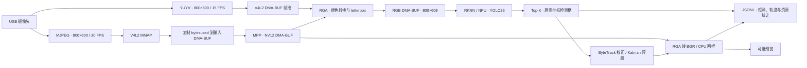
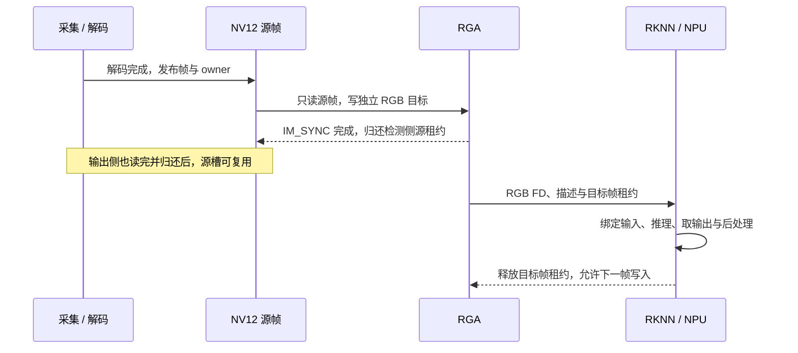

# RK3588 工业视觉部署

**C++17 · V4L2 · DMA-BUF · MPP · RGA · RKNN · YOLO26 · ByteTrack**

从真实 USB 摄像头采集，到硬件解码、图像预处理、NPU 检测和轨迹输出的一套 ARM64 Linux 视觉工程。重点是设备之间的缓冲共享、帧生命周期和实时调度，并对 FP16、INT8 与混合精度模型分别记录性能与资源占用。

在单路约 30 FPS 的交通回放中，INT8 与 Hybrid 均完成 **18,066 / 18,066 帧检测**；Hybrid 的模型文件为 **12.17 MiB**，稳态有效检测约 **30.11 FPS**、RSS 均值 **146.17 MiB**。

[实测结果](#results) · [系统架构](#architecture) · [工程实现](#engineering) · [模型接口](#model-interface) · [板端运行](#deployment) · [验证与资料](#validation)

本文根据 2026-10-18、2026-10-19 的板端开发及测试记录整理，日期均为北京时间。板端 `yolo_run/` 源码、模型和原始硬件日志独立存放；当前仓库发布这份部署展示，主机侧模型开发代码位于 [model/](model/)，服务端项目见 [主 README](readme.md)。

<a id="results"></a>

## 实测结果

### 三种模型，各连续运行 10 分钟

2026-10-19 使用相同交通 JPEG 序列回放：输入约 30.107 FPS，MPP 解码为 NV12，RGA letterbox 到 RGB 800×608；单路视频使用三个独立 RKNN Context，分别绑定 NPU Core0/1/2。关闭预览，保留画框和跟踪，`conf=0.25`、`--detect-fps 0`。

每个模型连续输入 18,066 帧，源时间跨度约 600.03 秒。性能和资源统计排除前 30 秒及末尾 30 帧；完成推理数为全程计数，硬件任务串行测试。

| 模型 | 模型大小 | 完成推理 / 输入帧 | 有效检测 FPS | RSS 均值 | CPU 均值 |
| --- | ---: | ---: | ---: | ---: | ---: |
| FP16 | 21.20 MiB | 8,658 / 18,066 | 14.42 | 252.21 MiB | 193.89% |
| INT8 | 11.62 MiB | 18,066 / 18,066 | 30.11 | 128.48 MiB | 30.53% |
| Hybrid，INT8 / FP16 | 12.17 MiB | 18,066 / 18,066 | 30.11 | 146.17 MiB | 37.93% |

- 按原始文件字节数统计，Hybrid 比 FP16 缩小约 **42.62%**，比 INT8 增大约 **4.74%**。
- INT8 和 Hybrid 的全部推理结果均被接受，没有推理等待槽丢帧或迟到结果丢弃。FP16 接受 8,655 个结果，3 个迟到丢弃，9,407 帧在等待槽被替换，1 帧在退出时舍弃。
- 稳态首尾各一分钟的 RSS 中位数变化分别为 **0 / 0 / +0.125 MiB**，FD 中位数均为 **46**。全程 NPU 最高温度分别为 **53.62 / 51.77 / 51.77°C**。

CPU 按单核 100% 计。三组均输出 18,066 帧，输出帧率与实际检测更新速度分别统计。INT8 和 Hybrid 的 30.11 FPS 受输入速率限制；该实验测得的是这组条件下的持续处理能力，尚未测最大吞吐。

### 真实摄像头链路

以下为 2026-10-18 各 3,000 帧的历史运行，与上面的回放长测分开统计。

| 链路 | 摄像头模式 | 输出 / 检测 FPS | 延迟记录 |
| --- | --- | ---: | --- |
| YUYV → RGA → RKNN | 800×600，15 FPS | 14.998 / 14.998 | 采集到结果 P95：110.076 ms |
| MJPEG → MPP → RGA → RKNN，split | 800×600，30 FPS | 30.00 / 30.00 | 输出 P95：36 ms；校正数据年龄 P95：104 ms |

YUYV 直接路径的稳态应用层上传为 **0 字节**。MJPEG 路径保留一次压缩包复制，再由 MPP、RGA 和 RKNN 通过 DMA-BUF 交接图像。输出延迟统计到画框或窗口提交完成，不包含曝光、屏幕扫描及远程显示。

<a id="architecture"></a>

## 系统架构



| 入口 | 输入与用途 | 输出 |
| --- | --- | --- |
| `camera_run` | YUYV 摄像头，逐帧检测 | 检测 JSONL、快照和运行汇总 |
| `camera_live` | MJPEG 摄像头，MPP 解码、异步检测与跟踪 | 交错的 detection / frame 记录、资源统计和预览 |
| `yolo_run` | 本地图片或视频，视频支持 LK 运动估计 | 检测或轨迹、标注图片 / 视频和汇总 |

摄像头原生输入为 **800×600**，模型输入为 **800×608**；RGA 在上下各补 4 行、填充值为 114，检测框最终恢复至 800×600 原图坐标。

<a id="engineering"></a>

## 工程实现

### 设备共享内存与帧生命周期

DMA-BUF FD 用于让设备导入同一底层分配；图像格式、可见尺寸、stride 和容量随帧描述一起校验。工程把长期分配与本帧占用分别管理：

| 层次 | 管理内容 | 归还条件 |
| --- | --- | --- |
| allocation | DMA-BUF FD、CPU 映射和 RGA handle，由 RAII 封装 | 所有设备注册及使用者释放后销毁 |
| 设备注册 | MPP buffer、RGA handle、当前 Context 的 RKNN 输入包装 | 确认设备访问结束后撤销，底层 allocation 保持有效 |
| 帧租约 `owner` | 当前像素仍被消费者使用 | 最后一个消费者完成后，池槽才允许复用或 V4L2 QBUF |
| CPU 访问区间 | `DMA_BUF_IOCTL_SYNC START/END` | 成对包围 CPU 读写，处理缓存一致性 |

NV12 解码帧同时供检测与输出两路读取。两路 RGA 完成后，各自释放源帧租约；NPU 使用独立的 RGB 目标，继续持有 RGB 租约直到推理与输出处理结束。



CPU 缓存同步、线程互斥与硬件执行完成各有职责。MPP 完成帧校验、RGA `IM_SYNC`、RKNN 阻塞执行及输出获取决定设备交接时机；无法确认硬件完成的异常路径按安全失败策略停止，避免提前回收仍可能被设备使用的内存。

### 缓冲复用与低拷贝

- V4L2 请求四个采集槽；MJPEG 压缩输入预分配四槽，MPP NV12 输出预分配八槽。池耗尽按路径丢弃并计数或报错，不自动扩容。
- 每个推理 Worker 独占 RKNN Context、RGB 预处理目标和输入输出缓冲。RGA 与 RKNN 注册在 allocation 不变时复用。
- RKNN 输入注册同时检查 allocation 所有者身份、FD、地址、容量和 stride，避免仅按 FD 整数缓存导致误复用。
- MJPEG 压缩包复制、CPU 画框以及可能的驱动或 Runtime 内部转换仍然存在。工程记录具体环节的复制量和缓冲共享情况。

### 有界并发与时间一致性

采集、解码、推理、轨迹校正和 JSONL 写入使用固定线程；输出线程负责 BGR 转换、画框和可选显示。

| 交接位置 | 容量 | 调度方式 |
| --- | ---: | --- |
| 待解码压缩包、待推理帧、待输出帧 | 各 1 | 保留最新等待项，替换旧项 |
| 检测结果队列 | 3 | 有界等待，持续满 250 ms 停止并报错 |
| 不可变轨迹快照历史 | 64 | 按时间保留近期状态 |
| JSONL 队列 | 64 | 有界等待，持续满 250 ms 停止并报错 |

队列替换只释放等待项的描述引用，设备正在使用的帧由独立租约保护。多 Worker 乱序返回时，校正线程用序号和时间水位拒绝迟到结果；输出选择不晚于当前帧时间的快照，再预测到该帧时刻。默认预测显示有效期为 500 ms。

| NPU 模式 | Context / Worker | 核心策略 |
| --- | ---: | --- |
| `default` | 1 / 1 | Runtime 默认核心选择 |
| `all` | 1 / 1 | 单 Context 绑定 Core0/1/2 |
| `split` | 3 / 3 | 三个 Context 分别绑定 Core0、Core1、Core2，对不同帧并发 |

`split` 的收益是持续视频吞吐和校正及时性，同时增加 Context 与缓冲占用。它与单 Context 的多核执行分别测试，单帧耗时、检测帧率、输出帧率和校正数据年龄也分别记录。

<a id="model-interface"></a>

## 模型接口与混合精度

| 接口 | 当前约定 |
| --- | --- |
| 主机 ONNX 输入 | `[1,3,608,800]`，NCHW，float32，RGB `/255` |
| 板端 RKNN 逻辑输入 | `[1,608,800,3]`，NHWC，UINT8 RGB |
| boxes 输出 | `[1,4,9975]`，模型画布上的 xyxy |
| scores 输出 | `[1,10,9975]`，已执行 Sigmoid |
| 最终检测 | 两阶段 Top-K，最多 300 框，阈值过滤并还原原图坐标 |
| 类别 | person、rider、car、truck、bus、train、motor、bike、traffic light、traffic sign |

板端使用 `rknn_create_mem_from_fd` 注册 RGB 输入，`rknn_set_io_mem` 绑定，`pass_through=0`；归一化和量化由 Runtime 按模型处理。输出请求 FP32 后进行后处理。当前 YOLO26 one-to-one 导出使用上述 Top-K 契约，不重复 Sigmoid，也不额外添加 NMS。

Hybrid 在主机转换阶段确定精度分配：先建立 PTQ INT8 基线，再比较逐层误差，将敏感位置保留为 FP16，其余适合的部分使用 INT8，最终导出固定计算图。板端加载已生成的混合精度模型，精度分配与三个 Worker 的帧调度独立进行。

文件视频还支持 LK 光流传播：RGA 负责灰度准备和缩放，LK 算法在 CPU 执行，用于检测间隔内的运动估计。

<a id="deployment"></a>

## 板端环境与运行

以下为 **RK3588 板端已有工程**的构建与运行方式。板端路径按实际部署位置填写；当前主机仓库的 C++ 构建继续遵循 [AGENTS.md](AGENTS.md)。

| 项目 | 板端记录 |
| --- | --- |
| 平台 | RK3588，aarch64，Linux 6.6.89-kdev |
| 构建 | C++17，系统 GCC/G++，CMake，Ninja |
| RKNN Runtime | 2.5.0，`/opt/rknn/runtime-2.5.0` |
| librga | 1.10.6，`/opt/rockchip/librga` |
| MPP | 官方源码构建版，`/opt/rockchip/mpp` |
| C++ OpenCV | 系统 4.10.0 |
| SDK CMake 接入 | `Rockchip::RKNN`、`Rockchip::RGA`、`Rockchip::MPP` |
| 模型转换 | 独立 Linux 主机使用 RKNN-Toolkit2，目标 `rk3588` |

板端工程布局：

```text
board-project/
├── yolo_model_rknn/       FP16、INT8、Hybrid 模型
├── yolo_run/
│   ├── camera/           V4L2、MPP、实时流水线
│   ├── image/            DMA-BUF、RGA、letterbox
│   ├── model/            RKNN Context、输入注册、YOLO26 后处理
│   ├── video/            文件视频、异步检测、LK
│   ├── tracking/         ByteTrack、Kalman、不可变快照
│   └── config/ deploy/ io/ metrics/
└── test/                 回归、故障注入、评测工具及原始记录
```

### 构建

在板端设置工程路径，并使用已有 preset：

```bash
board_project_dir=/path/to/board-project
cd "$board_project_dir/yolo_run"
cmake --preset rk3588-release
cmake --build --preset rk3588-release
```

产物为 `build-rk3588/yolo_run`、`camera_run` 和 `camera_live`。模型与类别表沿用板端配置；配置内相对路径以配置文件目录解析，CLI `--model` 相对当前工作目录解析。

### YUYV 逐帧检测

```bash
cd "$board_project_dir"
mkdir -p test/results
result_dir=$(mktemp -d "$board_project_dir/test/results/yuyv.XXXXXXXX")
env -u LD_LIBRARY_PATH -u LD_PRELOAD ./yolo_run/build-rk3588/camera_run \
  --io auto --max-frames 150 \
  --output "$result_dir/results.jsonl" --snapshot "$result_dir/snapshot.png"
```

`--io dmabuf` 强制直接路径，`copy` 使用 MMAP 后上传；`auto` 仅在 DMA-BUF 采集初始化失败时重建 MMAP 会话。默认使用 INT8 模型。

### MJPEG 实时检测与跟踪

```bash
cd "$board_project_dir"
result_dir=$(mktemp -d "$board_project_dir/test/results/live.XXXXXXXX")
env -u LD_LIBRARY_PATH -u LD_PRELOAD ./yolo_run/build-rk3588/camera_live \
  --preview off --decoder mpp --npu-mode split --max-frames 300 \
  --output "$result_dir/results.jsonl"
```

有图形会话时可用 `--preview on`。MPP 解码失败按错误处理，CPU 解码对照需显式选择 `--decoder opencv`。摄像头应使用 `/dev/v4l/by-id/` 的稳定节点，并核对实际协商的格式、stride 和 FPS。

<a id="validation"></a>

## 验证方法与资料

板端测试直接编译正式源码，覆盖以下行为：

- **像素与契约**：CPU / FD 输入对照、YUYV 直接与复制路径、NV12 非紧密 stride、RGB 补边、固定输入跨核心一致性。
- **生命周期**：旧帧仍被租用时拒绝覆盖，输出池耗尽与归还，生产者销毁后的租约存活，注册切换与清理配平。
- **并发与异常**：最新槽替换、关闭唤醒、迟到结果拒绝，以及推理和清理错误的故障注入。
- **资源与性能**：预热后的逐分钟 RSS / PSS / FD、检测与输出计数、丢帧位置、温度和延迟分位数。

在板端已有测试工程中执行：

```bash
cd "$board_project_dir/test"
cmake --preset rk3588-release
cmake --build --preset rk3588-release
env -u LD_LIBRARY_PATH -u LD_PRELOAD ctest --preset rk3588-release \
  -R '^(hardware|live_media|live_core)$' --output-on-failure
```

上述测试使用真实 MPP、RGA、NPU，需与其他硬件任务错开。真实摄像头租约检查另由 `camera_test --capture` 显式开启。

原始记录在板端工程内的位置如下，作为资料索引保留；这些文件未随本页上传：

| 记录 | 板端工程内路径 |
| --- | --- |
| 三模型、每模型 10 分钟长测 | `test/results/split_models_20261019_135622/report.md`、`report.json`、`final-verification.json` |
| 摄像头历史指标 | `test/reports/metrics.md`、`metrics.json` |
| DMA 输入与注册排查 | `test/validation/rknn_dma_input/report.md` |
| 板端整理与短测验收 | `test/reports/reorganization_validation.md` |

本页发布未重新执行硬件实验。已记录的范围是单路摄像头及单路交通回放；三路独立视频和更长时间的异常恢复仍需验证。
