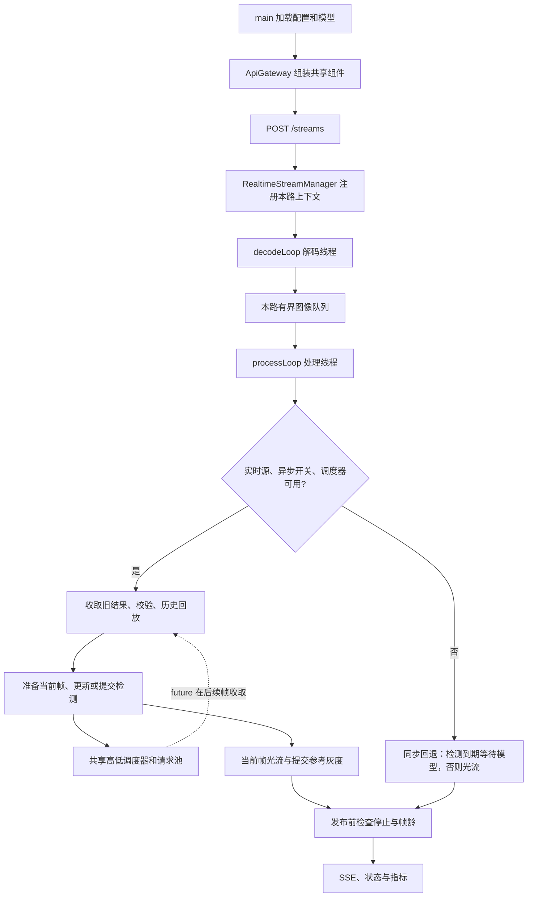

# 多路实时监测代码速读

源码核对：2026-10-11；文件名保留首次编写日期。本文用于定位源码；算法细节、指标口径和证据边界统一见[综合报告](系统实现与验证综合报告.md)，逐接口调用见[完整流程](初始化到多IP任务提交完整流程.md)。历史构建及实验记录见[报告导航](README.md)。

**每路独立解码、独立维护跟踪状态，共享高低模型和公平调度器；实时积压时处理新帧，通过低频检测与帧间光流减少模型调用。**

## 1. 整体关系

`StreamProcessor` 在本路处理线程内创建，保存 tracker、上一帧灰度和轨迹；不加载模型、不解码、不创建线程。实时与上传视频入口共享调度器，各自管理节奏、回放和输出。

## 2. 推荐源码阅读顺序

| 顺序 | 文件与重点入口 | 应回答的问题 |
| --- | --- | --- |
| 1 | [main.cpp](../../yolo_onnx_cpp/main.cpp)、[api_gateway.cpp](../../yolo_onnx_cpp/drogon/api_gateway.cpp)：构造与 `registerRoutes` | 配置、模型、调度器在哪里组装？ |
| 2 | [realtime_stream_handlers.cpp](../../yolo_onnx_cpp/drogon/realtime_stream_handlers.cpp)：`registerRealtimeStreamRoutes` | 如何创建、查询、停止和订阅？ |
| 3 | [realtime_stream_manager.cpp](../../yolo_onnx_cpp/stream/realtime_stream_manager.cpp)：`create / decodeLoop / takeNextFrame` | 每路有哪些状态？图像怎样入队或丢弃？ |
| 4 | 同文件：**`processLoop → processAsyncSingleModel / processAsyncHighLow → publish`** | 一帧怎样选择路径并形成输出？ |
| 5 | [stream_processor.cpp](../../yolo_onnx_cpp/stream/stream_processor.cpp)、[detection_cadence.h](../../yolo_onnx_cpp/stream/detection_cadence.h) | 准备、更新与提交状态怎样分离？何时检测？ |
| 6 | [inference_scheduler.cpp](../../yolo_onnx_cpp/model/inference_scheduler.cpp)：`submit / takeNext / run / finishTask` | 如何限制每流并发、公平轮转与过期？ |
| 7 | [yolo_engine.cpp](../../yolo_onnx_cpp/model/yolo_engine.cpp)：`initOpenVino / inferOpenVino / maxConcurrency` | 请求池实际多大？怎样借用和归还请求？ |

需要理解具体关联与候选生命周期时，再读 [ByteTracker](../../yolo_onnx_cpp/tracking/byte_tracker.cpp) 和 [AuthorityTracker](../../yolo_onnx_cpp/tracking/authority_tracker.cpp)。

## 3. 跟着一帧读

1. 选择异步或同步回退；本地文件不进入实时异步分支。
2. 取帧：实时合并到最新，文件 FIFO；实时按本地解码完成时间检查年龄。
3. 异步收取已完成 future，核对流、源帧、时间戳、历史与年龄，回放后再次检查。
4. `prepareFrame` 生成候选灰度和运动信息，质量下降可请求紧急高模刷新。
5. 按节奏更新等待票据或提交检测；已执行任务不可替换，高低各有一个 pending 槽位。
6. 异步用校正后的状态传播当前帧；同步在检测到期时等待结果，否则光流。
7. `finishFrame` 提交参考灰度，`publish` 检查停止与年龄并更新计数。
8. 结束时取消等待票据、发布终态；不强制中断执行中的模型调用。

顶层 SSE 帧号表示当前输出，`inference_updates` 表示本次接受的旧检测来源；一条事件可以接受高低两次更新。不同流的轨迹 ID 可重复，应与流 ID 一起使用。

## 4. 容易读错的边界

| 问题 | 结论与详细说明 |
| --- | --- |
| 同帧检测和光流是否算两帧？ | 不重复推进；ByteTracker 的接受帧 tick 与 AuthorityTracker 的源索引年龄不同，见[跟踪时钟](系统实现与验证综合报告.md#tracking-clock)。 |
| 哪个队列丢了任务？ | 解码队列、推理队列、回放历史与 SSE 缓存分别处理，见[资源调度](系统实现与验证综合报告.md#scheduling)。 |
| 模型完成是否等于检测输出？ | 还需要上下文、年龄、回放与发布检查，见[结果核算](系统实现与验证综合报告.md#replay)。 |
| `detection` 事件是否代表模型调用？ | 光流也用此事件名，需读 `detection_frame / model_tier / inference_updates`。 |
| 201 或 ready 是否证明视频源可用？ | 201 仅注册完成，ready 仅检查管理器存在；还要看流状态与计数。 |
| SSE 断线是否停止流？ | 不停止；终态记录仍占容量，DELETE 收尾后释放，见[生命周期](初始化到多IP任务提交完整流程.md#lifecycle)。 |
| 目标 4/1 FPS 是否已达到？ | 是低/高模型预算，不是实测；光流输出率另算，见[测量口径](系统实现与验证综合报告.md#measurement)。 |

模板 `config.multistream.yaml` 的起点是容量 4、队列深度 2、年龄门槛 300 ms、低/高预算 4/1 FPS。这些是配置值，容量结论需查看[对应历史证据](系统实现与验证综合报告.md#evidence)。

## 5. 用哪些测试复核

| 理解 | 测试入口 |
| --- | --- |
| 任务替换、更新/取消、上下文和计数 | [inference_scheduler_test.cpp](../../yolo_onnx_cpp/test_cpp/inference_scheduler_test.cpp) |
| 请求池并发与隔离 | [yolo_engine_concurrency_test.cpp](../../yolo_onnx_cpp/test_cpp/yolo_engine_concurrency_test.cpp) |
| 同帧时钟、空光流、参考帧提交与回放隔离 | [stream_processor_test.cpp](../../yolo_onnx_cpp/test_cpp/stream_processor_test.cpp) |
| 候选、权威校正与区域语义 | [authority_tracker_policy_test.cpp](../../yolo_onnx_cpp/test_cpp/authority_tracker_policy_test.cpp) |
| 检测频率及过期边界 | [detection_cadence_test.cpp](../../yolo_onnx_cpp/test_cpp/detection_cadence_test.cpp)、[frame_deadline_test.cpp](../../yolo_onnx_cpp/test_cpp/frame_deadline_test.cpp) |
| 文件背压、双路隔离、累计量与 SSE | [realtime_stream_manager_test.cpp](../../yolo_onnx_cpp/test_cpp/realtime_stream_manager_test.cpp) |

本次仅做文档和源码静态核对，没有重新运行构建或以上测试。多路验收入口为 [multistream_acceptance.py](../../yolo_onnx_cpp/tools/multistream_acceptance.py)，结果区分 PASS / FAIL / INCOMPLETE；单元测试与本地四路八小时记录均不能替代真实 RTSP、目标 CPU 和业务精度验收。
