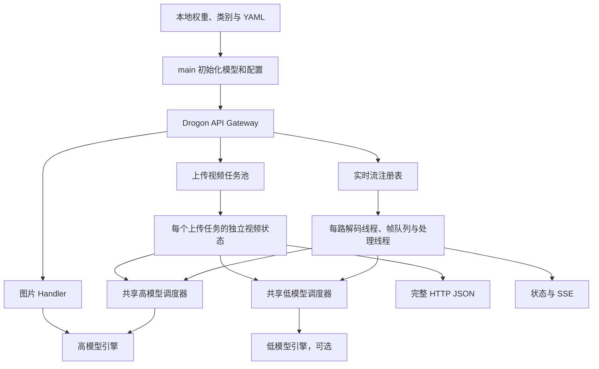

# VisionTrack 系统实现与验证综合报告

源码核对日期：2026-10-11。本文整合模型开发、部署、视频跟踪、多路调度与测量口径；具体 HTTP 初始化和请求代码保留在[完整调用流程](初始化到多IP任务提交完整流程.md)。历史实验按各自日期和源码状态引用，本次文档整理不构成重新运行或业务验收。

阅读目录：[能力与框架](#capabilities) · [训练与量化](#model-pipeline) · [视频算法](#tracking) · [跟踪时钟](#tracking-clock) · [检测节奏](#cadence) · [阈值与 ROI](#quality-controls) · [资源调度](#scheduling) · [结果回放](#replay) · [接口与结束](#lifecycle) · [测量口径](#measurement) · [已有证据](#evidence)。

<a id="capabilities"></a>

## 1. 当前能力与交付边界

| 能力 | 当前实现 | 验证边界 |
| --- | --- | --- |
| 图片检测 | C++ 服务、Web 与 Qt；检测框、类别和分数 | Qt 本地加载模型，Web 经 HTTP；不是同一个接入路径 |
| 上传视频 | 单模型或 High/Low、动态 stride、光流、跟踪和异步校正 | 完整处理后返回一次 JSON，结果不持久化 |
| 实时监测 | 每路独立状态、共享调度、SSE、重连和丢旧策略 | 本地多路已有证据，真实 RTSP 与业务质量尚需验收 |
| 质量控制 | 类别阈值、静态高模 ROI、稳定/候选轨迹规则 | 配置和算法已实现，场景收益需真值验证 |
| 模型优化 | base/hard/distill 训练及 PTQ/QAT 脚本 | QAT 已完成小输入和一轮临时数据验证，未完成正式训练与精度对比 |
| 运行观测 | HTTP/流日志、阶段统计、Prometheus 指标与验收工具 | 已有指标不等于日志轮转、告警或持久化任务系统 |

部署使用 `/root/vcpkg` 的 GCC15 工具链和 C++17；训练、导出与 Python 工具使用 `yolo` Conda 环境。`rag-api` 不参与检测链路。默认 `.onnx + auto` 走 ONNX Runtime，OpenVINO 配置需使用对应构建 preset。

## 2. 架构、状态与线程



图中省略了模型结果回传的反向连线：上传任务接收自己的调用结果，调度请求使用独立 promise/future，实时流再将结果应用到本路跟踪状态。没有按客户端 IP 分发结果的中央路由器。

| 资源 | 共享范围 | 实际作用 |
| --- | --- | --- |
| 高/低模型及请求池 | 进程内，每级一份 | 模型权重与推理并发 |
| 高/低调度器 | 进程内，每级一份 | 按流排队、公平选择与任务票据 |
| 上传视频任务池 | 进程内一份 | 执行整段视频；容量满返回 503 |
| 帧队列、跟踪器、灰度与回放历史 | 每路流或每个上传任务独立 | 保持帧身份、轨迹关联与时间连续性 |
| SSE 序号、订阅者与事件缓存 | 每路流独立 | 新结果投递及有限历史补发 |

HTTP I/O 线程、视频 worker、调度 worker、每路两条线程、OpenCV/模型内部线程是不同资源。`StreamProcessor` 管理本路状态，自己不创建线程、不加载模型。图片 Handler 直接调用共享引擎；上传视频与实时流经共享调度器调用模型。

实现入口：[Gateway](../../yolo_onnx_cpp/drogon/api_gateway.cpp)、[实时流管理器](../../yolo_onnx_cpp/stream/realtime_stream_manager.cpp)、[StreamProcessor](../../yolo_onnx_cpp/stream/stream_processor.cpp)。

<a id="model-pipeline"></a>
## 3. 训练、导出与量化流程

### 3.1 训练数据与阶段

`model/train.py` 的流程为：参数和设备检查 → 数据/标签检查 → 采样清单与 YAML → 训练 → 按配置验证最佳权重。

| 阶段 | 输入与训练行为 | 应保留的对比条件 |
| --- | --- | --- |
| `base` | 本地检测权重或结构，按类别频率进行受增长上限约束的重复采样 | 数据划分、类别顺序、采样配置、seed 与输出目录 |
| `hard` | 基础权重及困难样本清单，在基础采样列表上增加重复次数 | 样本必须属于 train 并具有配对标签，不借用 val/test |
| `distill` | 本地 teacher 与 student，原生检测损失加分类/框响应蒸馏 | 类别、检测头分支、stride 和响应 shape 兼容 |

重复采样生成路径清单，不复制整套图片；增长上限避免少数类过度重复。困难样本挖掘入口为 [mine_hard_samples.py](../../model/mine_hard_samples.py)。蒸馏在 `one2many/one2one` 响应上计算分类 KL 和高置信框损失，teacher 不更新梯度，损失关键计算转为 FP32，避免 AMP 归约溢出。

训练 `--imgsz` 是单个最长边尺寸；导出 `--imgsz HEIGHT WIDTH` 是固定高、宽。矩形训练 batch 不保证每个 batch 都与部署 shape 相同。`--dry-run` 不启动训练，但仍生成配置和采样清单，不能当作纯只读检查。

代码依据：[训练](../../model/train.py)、[蒸馏](../../model/distillation.py)。

### 3.2 FP32 与 INT8 的不同产物

| 流程 | 算法与产物 | 重要边界 |
| --- | --- | --- |
| 现有导出 `onnx.py` | 从临时 `.pt` 副本导出 FP32，可进行 QDQ PTQ | 保留既有导出行为，输出不得覆盖 |
| 新 PTQ `ptq_int8.py` | 同一源权重导出 FP32，MinMax 校准后生成 `ptq_int8.onnx` | 不训练，默认用 train 校准 |
| 新 QAT `qat_int8.py` | 校准初始化、伪量化微调、冻结 observer，生成 `qat_int8.onnx` | 导出保留训练得到的 qparams，不再重新 PTQ |

新 PTQ/QAT 对比脚本统一 Conv 输入 U8、权重按输出通道对称 S8；bias、Conv 输出、模型输入输出及其他算子保留 FP32。它们与旧 `onnx.py` 的 PTQ 输出量化设置不完全相同，比较 PTQ/QAT 应使用两套新脚本。

QAT 只折叠 Conv/BN，不直接调用会移除 YOLO26 训练分支的完整 `model.fuse()`；保留两种训练头，关闭 AMP，不对 observer 与权重分别做 EMA。检查点以 FP32 保存，导出时将常量权重 QDQ 打包为真正的 INT8 initializer。`.pt` 含伪量化模块，不能称为原生 PyTorch INT8 推理模型。

两种新流程均记录源权重、数据 YAML、校准图像内容指纹、shape、量化卷积数量与文件哈希，输出目录必须不存在。QAT 当前只支持单卡/CPU，`auto` 使用第一张可见 GPU，无 CUDA 时回退 CPU。命令、冻结 epoch 与对比条件见 [PTQ/QAT 说明](../../model/quantization.md)。

<a id="tracking"></a>
## 4. 检测、光流与轨迹分工

### 4.1 从像素到检测框

图像解码 → letterbox/resize → BGR 转 RGB → `[0,1]` 归一化 → NCHW float32 → 模型 → 输出解析 → 坐标还原 → 分类别 NMS。

当前部署 YOLO26 的 TopK 输出为 `[1,300,6]`，字段为 `x1,y1,x2,y2,score,class_id`；这不表示模型图一定内置 NMS。C++ 仍执行外部 NMS，解码器也保留旧原始候选输出的兼容路径。图片和视频坐标最终落在原图像素系中。

后端标量/类别阈值在模型输出解码时过滤目标；Web 的 `UI score filter` 只过滤已返回的框，两者不能互相替代。依据：[图片预处理与解码](../../yolo_onnx_cpp/image/image_processing.cpp)、[YoloEngine](../../yolo_onnx_cpp/model/yolo_engine.cpp)。

### 4.2 单模型与双模型

| 环节 | 单模型 | High/Low |
| --- | --- | --- |
| 模型职责 | 高模型确认目标 | 高模建立/校正权威状态，低模较频繁修正几何并提供候选 |
| 关联 | ByteTracker 的 Kalman 预测与两阶段匹配 | AuthorityTracker 的 stable/provisional 生命周期与几何约束 |
| 中间帧 | LK 提供带 ID 的目标传播，不创建新目标 | 逐轨迹运动投影；允许时使用全局运动兜底 |
| 候选与去重 | 轨迹激活、丢失与移除 | 候选获高模确认后保留 ID 晋升，稳定/候选及输出均有去重 |

ByteTracker 还有自身关联阈值：当前新建轨迹门槛 0.45，低分关联门槛 0.1。服务端先以 0.25 过滤时，低于 0.25 的框不会进入跟踪器；调低某类检测阈值不会同时修改跟踪器的新建门槛。

LK 的质量检查包含采样点数量、有效比例、前后向一致性、位移离散、跳变与边界情况。光流只延续已有目标；质量恶化可触发更早的模型刷新。灰度/金字塔复用是减少重复计算的机制，不能直接推出精度提升。

代码依据：[ByteTracker](../../yolo_onnx_cpp/tracking/byte_tracker.cpp)、[AuthorityTracker](../../yolo_onnx_cpp/tracking/authority_tracker.cpp)、[光流](../../yolo_onnx_cpp/video/optical_flow_tracker.cpp)。

<a id="tracking-clock"></a>
## 5. 四种时钟与同帧更新

| 时钟 / 身份 | 当前用途 | 易混淆之处 |
| --- | --- | --- |
| `frame_index` / 媒体时间戳 | 定位源帧与异步校正来源 | 不是 SSE 输出序号 |
| ByteTracker 接受帧 tick | 每个不同的已接受源帧预测一次 | 同帧光流和检测不会重复 tick；源索引跳跃不额外添加 tick |
| AuthorityTracker 源帧年龄 | 按源索引差累计未获检测校正的年龄 | 实时丢帧后仍计入跳过的源帧间隔，同帧更新不重复老化 |
| 本地 `captured_at` 单调时钟 | 实时检测预算与解码到结果的新鲜度 | 不包含相机采集、网络或解码器内部缓冲时间 |

例如同一源帧 8 先应用光流、后应用检测，ByteTracker 只预测/推进一次；下一个已接受源帧为 12 时再推进一次。AuthorityTracker 则根据 8→12 的差额处理年龄。这是两种跟踪器的既定策略，不能用同一 tick 规则描述它们。

`StreamProcessor.applyFlow` 在空光流轨迹时仍调用单模型跟踪器；否则 lost 状态可能因空帧不更新而冻结。`prepareFrame` 生成候选灰度与运动信息，`finishFrame` 才提交参考帧；准备后被过期检查丢弃的图像不能变成下一次光流锚点。

当前同帧去重与源索引老化规则会影响轨迹寿命、ID 和逐帧输出。10 月早期 High + LK 报告记录的是修复前结果，旧报告与当前重跑不能直接拼接。回归依据：[stream_processor_test.cpp](../../yolo_onnx_cpp/test_cpp/stream_processor_test.cpp)。

<a id="cadence"></a>
## 6. 不同入口的检测节奏

| 入口 | 调度依据 | 异步行为 |
| --- | --- | --- |
| 上传单模型 | `ceil(source_fps / video_detect_fps)` 形成基础 stride，dynamic 调整间隔 | `AsyncInferWorker` 执行模型并补偿旧检测 |
| 上传 High/Low | 低模按 stride，高模周期由基础 stride 推导，必要时提前触发 | 高模可异步；低模在文件处理线程等待结果 |
| 单模型实时流 | `video_detect_fps` 预算 | 实时源和调度器可用时非阻塞轮询、回放 |
| 双模型实时流 | 低模 `video_detect_fps`，高模 `video_high_detect_fps` | 高低各自一个 pending 槽位，不互相占用同一个 future |

实时异步分支按本地解码经过时间调度，避免直接按摄像头声明的 FPS 计数。首帧优先高模；高模频率为 0 时停止周期刷新，保留必要的首帧和紧急刷新。忙碌级别不消耗未获接纳的到期预算。

本地文件、关闭异步或缺少所需调度器时走同步处理分支。`video_stride_mode` 主要用于上传视频，不应解释为实时流全部采用同一 dynamic stride 实现。实现：[DetectionCadence](../../yolo_onnx_cpp/stream/detection_cadence.h)、[上传单模型](../../yolo_onnx_cpp/video/video_inference.cpp)、[上传双模型](../../yolo_onnx_cpp/video/video_inference_high_low.cpp)。

<a id="quality-controls"></a>
## 7. 分类别阈值与静态 ROI

### 7.1 阈值继承

`class_conf_thresholds` 按 class ID 顺序设置；空列表保留标量阈值，元素 `-1` 回退标量。低模型 `low_res_class_conf_thresholds=[]` 继承高模型列表；若希望低模型各类只使用自己的标量值，应显式提供全 `-1` 列表。

类别名称来自服务 YAML，不由模型文件名决定。类别列表、`num_classes` 与实际模型类别顺序需要一致；导出的 `classes.json` 用于核对，不是服务自动加载类别的入口。配置解析见 [app_config.cpp](../../yolo_onnx_cpp/config/app_config.cpp)。

### 7.2 高模型 ROI

ROI 是单个归一化静态裁剪，默认关闭；它不是动态不确定区域选择或多 ROI 系统。高模第一轮、紧急刷新以及按配置计数触发的全帧兜底仍处理完整画面。

```text
全帧 → 选择 crop → 裁剪后 letterbox → 高模型
→ 恢复裁剪内坐标 → 加上 crop 左上角偏移 → 全帧坐标
→ updateHighResRegion，仅对区域内应用权威校正
```

区域外轨迹依靠既有投影和年龄规则继续处理，不能因一次 ROI 中未检测到它们就当作全帧漏检。回放必须保留对应 crop/region，以源帧的 ROI 解释旧结果。裁剪后仍使用配置的固定模型输入 shape，因此不能仅凭 ROI 面积推断模型推理按比例加速。

实现：[high_res_roi.h](../../yolo_onnx_cpp/stream/high_res_roi.h)、[区域跟踪与回放回归](../../yolo_onnx_cpp/test_cpp/authority_tracker_policy_test.cpp)。

<a id="scheduling"></a>
## 8. 队列、并发与公平性

| 队列 / 缓冲 | 内容与容量 | 满载或结束行为 |
| --- | --- | --- |
| 上传任务池 | 整段视频任务，执行线程与等待深度分别配置 | 队列满返回 503；响应裁剪不减少已经执行的推理 |
| 每路解码队列 | BGR 帧，使用 `per_stream_queue_depth` | 实时丢最旧；处理端再合并到最新；文件施加背压 |
| 每级模型队列 | 按 `stream_id` 组织的张量与上下文 | 同流队列满替换最旧等待任务，future 返回 `Replaced` |
| 回放历史 | 单模型最多 32 帧灰度，双模型最多 60 帧运动/检测事实 | 淘汰前推进基准跟踪器，不能保留无限历史 |
| SSE 缓存 | 每路最多 256 个事件、32 个订阅者 | 超范围游标报错，不提供进程重启恢复 |

每个调度器对同流限制一个 in-flight；高低两级独立，因此同一路可同时占有高、低模型任务。ready 队列按流轮转，有普通任务等待时紧急任务最多连续取 3 次。公平性约束选择顺序，不保证各路 FPS 相等。

排队票据是弱引用：尚在队列里的张量可更新为本路较新帧，已出队任务不可修改；`updated_count` 不增加 `submitted_count`。DELETE 收尾可取消等待票据，不能强制中断已执行的推理。调度器接口见 [inference_scheduler.h](../../yolo_onnx_cpp/model/inference_scheduler.h)。

OpenVINO 的应用 InferRequest 池、插件内部 `NUM_STREAMS`、模型线程数和调度 worker 数是不同概念。显式请求数量会作为 hint，并用于创建应用池；为 0 时读取编译模型的最优请求数。调度 worker 与引擎 `maxConcurrency()` 对齐，借用请求后通过 RAII 归还，包括异常路径。不能把应用池 4 简写成插件一定有 4 个原生 streams。

模型线程高模为 0 时回退 `thread_num`，低模为 0 时继承解析后的高模线程数；`opencv_threads=0` 不主动设置 OpenCV 线程。旧单实例 16 线程最优不代表高低模型并行或 NUMA 节点上的最优配置。

<a id="replay"></a>
## 9. 异步结果为什么需要回放

```text
源帧送检 → 后续帧继续光流 → future 完成
→ 校验 stream/frame/timestamp → 检查源帧年龄与历史可用性
→ 在历史基准副本中应用检测 → 按帧重放至当前状态
→ 提交前再次检查年龄 → 恢复本路跟踪器 → 发布当前帧
```

单模型保存灰度历史，使用校正后的轨迹重新计算传播；双模型保存运动、检测与 ROI 事实，根据修正后的 tracker 重建投影。同帧高模结果优先于低模，淘汰旧历史前先推进基准状态，避免回放从错误时间点开始。

结果可在模型执行成功后仍因过龄、历史被淘汰或回放后再次过龄而无法应用。顶层 SSE 帧号属于当前输出，`inference_updates` 标明旧检测来源；一条事件可以应用高低两次校正。`detection` 事件名也用于纯光流帧，不能据此计算模型调用率。

| 计数 | 统计位置 | 不应等同于 |
| --- | --- | --- |
| scheduler completed | 引擎调用成功 | 已应用或已发布的检测 |
| replay completed | 上下文校验后收取的完成结果 | 全部调度器完成任务 |
| replay applied | 回放后成功提交校正 | 当前帧一定已成功发布 |
| expired / evicted | 年龄拒绝 / 历史不可回放 | 解码帧队列丢帧 |
| 流 detection count | 实际接受并计入事件的检测更新 | `detection` SSE 事件数量 |

跨层计数的差额需要按同一流、同一时间窗及收尾状态核算，不能直接套一个守恒式；排队、执行中、完成未收取及接受后发布拒绝都可能造成差额。代码：[双模型回放](../../yolo_onnx_cpp/stream/stream_inference_replay.h)、[单模型回放](../../yolo_onnx_cpp/stream/single_model_inference_replay.h)。

<a id="lifecycle"></a>
## 10. 接口、结束边界与日志

上传接口处理完后返回 JSON；帧 offset/limit 是本次结果数组裁剪，不是可查询的持久化分页。重新请求会重新计算。实时流创建成功 201 仅表示注册完成，需查询状态与计数确认连接和处理正常。

SSE 未带游标时接收新事件，携带 `Last-Event-ID` 时补发缓存中的后续事件；普通事件 `detection`，终止 `end`。断开订阅不停止视频源。终态流仍占注册容量，DELETE 才释放；DELETE 要等待线程收尾，帧龄阈值不是严格的停止超时保证。

请求门禁使用环境变量中的共享 Bearer token，不提供账号/角色系统；IP 限流读取 TCP 对端，不自动信任转发头。经反向代理时多个客户端可能共用代理 IP 桶。`/health` 和 `/ready` 免门禁，`/metrics` 不免；ready 只检查流管理器存在。

结构化日志按字段白名单记录 request/stream 身份、状态和性能计数。上传日志不记录原文件名与原始异常，流日志不记录源地址；流状态接口的 URI userinfo 遮盖不能视为对全部查询参数做脱敏。流计数移除时并入 retired 累计，进程重启后统计重置。

实现与状态码的详细对应见[完整流程第 5、8 节](初始化到多IP任务提交完整流程.md#client-ips)。

<a id="measurement"></a>
## 11. 性能与精度的测量口径

### 11.1 FPS、阶段耗时与资源

| 指标 | 正确解释 |
| --- | --- |
| source FPS | 输入媒体的帧率 |
| 目标检测 FPS | 配置中的模型调用预算，不是达到的吞吐 |
| 实际检测刷新率 | 指定窗内接受的高/低检测次数除以窗长 |
| output / average FPS | 实际处理或发布的帧数量除以对应墙钟时间，包含光流结果 |
| `execution` | 完整引擎调用，包含请求获取、输入复制、infer 和后处理等 |
| `infer` / `postprocess` | execution 的内部阶段，不可再与父阶段相加 |
| `frame_work` / `prepare` / `weak_flow` | 父子处理墙钟阶段，不是互斥的 CPU 时间 |
| completion pickup | 模型完成到处理线程收取的延迟，可揭示处理端忙碌 |
| result age / commit age | 解码到收取 / 提交的年龄，用于判断回放前后过龄 |

实时诊断用固定数量的 `count/sum_ms/max_ms`，不会无限保留逐请求样本。均值为 sum/count，合并最大值取 max，不能从这三项恢复 P95；验收工具按自身采样口径统计分位数。

异步各线程累计阶段可能超过整次墙钟时间。进程 CPU 是 CPU 秒/墙钟秒×100%，可超过 100%；除以逻辑 CPU 数后才是整机容量归一化值。RSS 是进程驻留内存，包含模型、运行时、解码、光流与结果缓存，不能拿模型文件压缩比例代替内存下降比例。

SSE `result_age_ms` 固定于发布时，状态 `latest_result_age_ms` 在查询时继续增长；首次结果前的 0 是占位值。二者均从本地解码完成计算，不是相机采集至浏览器的总延迟。

源码依据：[实时诊断](../../yolo_onnx_cpp/stream/inference_diagnostics.h)、[性能统计](../../yolo_onnx_cpp/metrics/performance_metrics.h)、[指标接口](../../yolo_onnx_cpp/drogon/realtime_stream_handlers.cpp)。

### 11.2 精度评测与数据划分

早期视频报告以高模型输出作伪标签，P/R/F1 衡量算法一致性，不是人工真值精度。后续 BDD 真值评测需区分模型检测、全部跟踪输出、检测帧及 LK 补齐帧；固定 0.25 截断后的 AP 不能与低候选阈值的完整 mAP 混称。

crowd/distractor 的忽略逻辑、类别映射、标注帧与源帧 stride 对齐必须一致；ID 数量减少不能直接证明身份保持更好。官方 TrackEval 指标需要对应的标注与准备流程，不用自有框匹配分数替代 HOTA/IDF1。

校准、困难样本挖掘与 QAT 微调使用 train；保留独立 val/test 做评估。PTQ/QAT 先核对模型和校准指纹，再使用相同预处理、阈值、NMS、后端、线程、请求池和预热条件比较。QAT 有额外训练成本，当前没有正式结果证明它优于 PTQ。

工具入口：[检测/跟踪真值评测](../../yolo_onnx_cpp/tools/evaluate_bdd100k_tracking.py)、[量化精度评测](../../yolo_onnx_cpp/tools/evaluate_bdd100k_openvino_quantization.py)、[TrackEval 准备](../../yolo_onnx_cpp/tools/prepare_bdd100k_trackeval.py)。

<a id="evidence"></a>
## 12. 已有证据与剩余验证

| 证据 | 支持的结论 | 不能据此宣称 |
| --- | --- | --- |
| [2026-07-10 初期算法对比](video_algorithm_comparison_20260710.md) | 五种策略当时的速度与伪标签一致性差异 | 当前默认算法最优或业务真值合格 |
| [同日后续优化回归](../test-results/video_compare/video_algorithm_optimization_20260710/) | 后续 High/Low 轨迹优化的单独结果 | 与初期报告属于同一轮结果 |
| [2026-09-03 线程基准](../test-results/onnx_thread_benchmark/20260903_020914_utc/combined_report.md) | 同 C++ 链路单实例后端/线程延迟 | 多路容量及 NUMA 最优配置 |
| [2026-09-27 多路终态](../test-results/multistream_local_20260927/README.md) | 本地四路完整八小时原门槛 PASS；八路短窗 FAIL | 真实 RTSP 或八路长期通过 |
| [六路长期记录](../test-results/multistream_local_20260922/README.md) | 六路八小时性能 FAIL，尾部采集审计存在缺口 | 经短窗通过覆盖长期失败 |
| [2026-09-28 参数对照](../test-results/multistream_local_20260928/README.md) | 线程/池/过期结果的受控定位 | 单节点已形成稳定生产候选 |
| [2026-10-08/10 High + LK](../test-results/high_stage_cpu_20261010/README.md) | 修复前同步单模型的量化收益及阶段成本 | 当前跟踪时钟、多路或 QAT 的收益 |
| [PTQ/QAT 回归测试](../../model/test_quantization.py) | 梯度、冻结、训练头、QDQ/INT8 打包等脚本行为 | 正式精度、速度或跨机器泛化 |

实施记录第 75.1 节只有候选启动描述，未附完整终态。本次整理没有查看实时进程，也不把该记录当作仍在运行或已经通过的任务。

剩余验证重点是：当前代码的同条件复跑、独立长尾/业务真值、真实摄像头重连与长期不可用、生产持续运行及故障恢复。已有实现、回归通过、短窗通过、长期通过和业务验收应分别记录。

## 13. 本次核对范围

本次仅整理文档：核对所述函数、配置、状态、类型和已有测试断言，校验文档链接、代码摘录及示例语法。没有修改业务接口、运行配置、模型、数据集或历史测试产物，也没有新执行构建、训练、推理或长期压测。

后续补实验时，应记录源代码状态、模型/输入哈希、后端及实际 runtime 属性、采集时间窗、预热与阈值、原始 PASS/FAIL/INCOMPLETE 和收尾情况。只补缺失证据，不用新结果覆盖旧失败。
