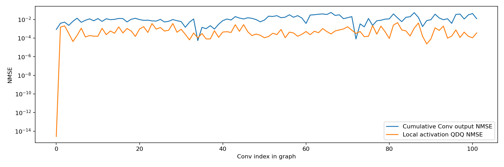
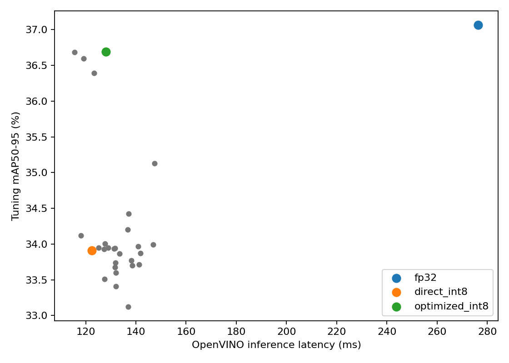
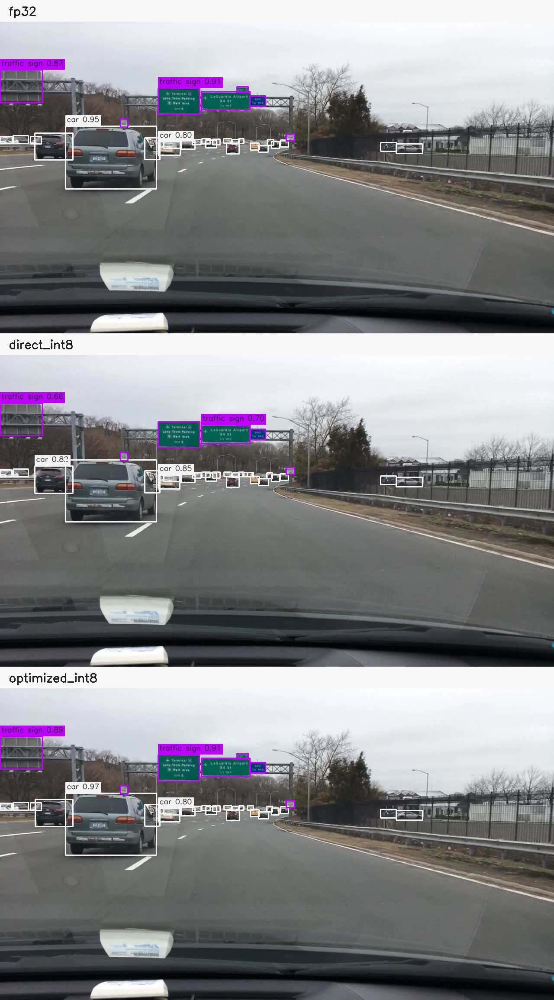
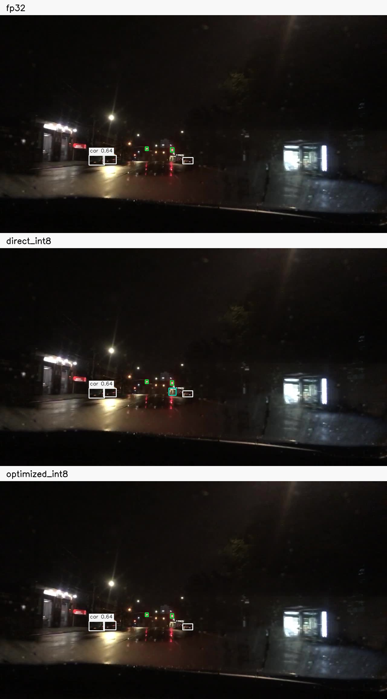
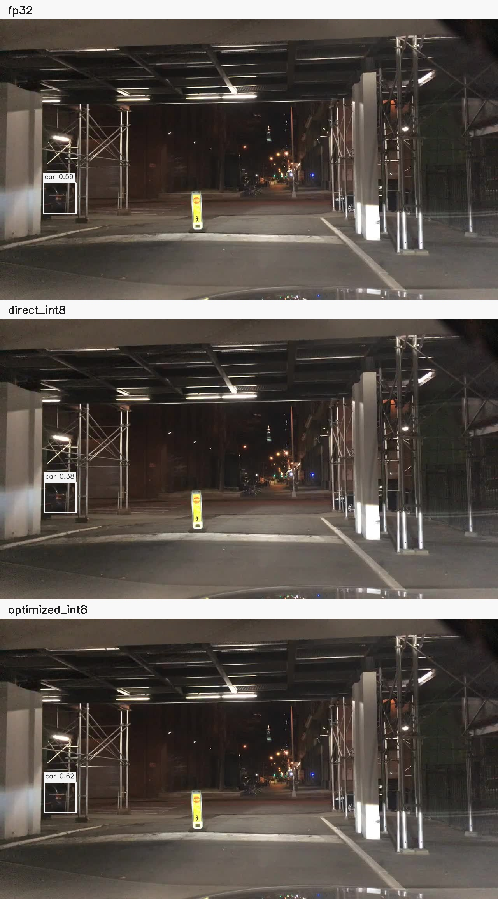

# 高模型 PTQ 逐层诊断与优化报告

生成时间：2026-10-12T20:29:56.351537+08:00。本报告三组数据均为本次实测。

GitHub版本仅发布报告、对照图、校准与数据哈希清单及聚合指标；公开汇总见[summary_public.json](summary_public.json)。模型权重、`measured/`逐样本记录和含逐次计时样本的完整`summary.json`保留在本地。下文提及这两类原始记录时，指本地实验目录；公开汇总保留三轮聚合延迟及实际Conv执行精度，不包含逐次计时数组。

优化状态：**达到精度与速度目标**。最终模型是 INT8/FP32 混合精度 PTQ，没有训练或权重更新。

## 三组验证结果

| 模型 | mAP50 % | mAP50-95 % | P % | R % | F1 % | 平均 ms | P95 ms | FPS | 文件 MB | RSS MiB | INT8/FP32 Conv |
|---|---:|---:|---:|---:|---:|---:|---:|---:|---:|---:|---:|
| fp32 | 60.583 | 35.033 | 83.90 | 68.55 | 75.45 | 255.840 | 371.371 | 3.91 | 38.400 | 725.85 | 0/102 |
| direct_int8 | 58.519 | 32.415 | 82.74 | 67.60 | 74.41 | 117.817 | 191.900 | 8.49 | 10.209 | 677.57 | 102/0 |
| optimized_int8 | 60.209 | 34.857 | 84.31 | 67.74 | 75.12 | 116.333 | 188.382 | 8.60 | 10.556 | 679.30 | 94/8 |

独立验证集的mAP50-95损失由2.618个百分点缩小到0.176个百分点；相对直接INT8提升2.442个百分点。
恢复了93.27%的直接PTQ损失。该比例以同一独立验证集的FP32基线计算，不来自调优集。

推理时间节省保留比例：101.08%。
延迟仅覆盖同步 infer 和输出读取，不含图片读取、预处理、后处理、模型编译；吞吐为单请求 1000/平均延迟。RSS 为三轮推理结束时的独立进程驻留内存均值，不是运行期连续采样均值，也不是模型独占内存。

## 数据与方法

输入固定为 [1,3,736,1280]；种子42，训练集200张校准、另32张逐层诊断；验证集256张调优、另1000张最终评测。路径、图片与标签 SHA-256、逐类真值数见 data_selection.json。最终评测集未用于选择排除层。
这不是完整1万张验证集验收；各类别样本量见逐类表，稀有类样本不足时不能据此证明该类的泛化精度恢复。
原始部署模型 opset12 转为13并预处理，转换一致性记录见 parity.json。直接与优化 PTQ 共享 MinMax 统计；Conv输入U8、权重逐通道S8；bias、Conv输出及其他算子保持浮点。
三组均为 OpenVINO CPU、8线程、单请求、LATENCY、浮点精度FP32。各模型独立进程预热10次，用相同100张图片执行三轮，轮换顺序；编译后实际算子精度见各轮JSON。
mAP采用仓库AP101匹配，在IoU 0.50:0.05:0.95上平均；候选下限0.001，P/R/F1置信度0.25，外部class-aware NMS IoU0.45。TopK输出先解码再匹配，逐层比较发生于TopK之前。
SQNR为无误差时记null；零参考张量的NMSE使用1e-30分母。局部QDQ误差来自同一量化图内Q前/Q后张量，累计误差包含上游传播。仅输入激活统计超出校准范围的比例，权重与浮点Conv输出的该字段为null（不适用）。
逐层诊断使用关闭图优化的ORT CPU，会与OpenVINO融合后的真实内核有数值差异；最终精度与速度结论以OpenVINO实测为准。诊断方法参考[ORT官方量化文档](https://onnxruntime.ai/docs/performance/model-optimizations/quantization.html)。

## 敏感层与消融



| 节点 | 累计输出 NMSE | 局部 QDQ NMSE | 权重 NMSE | 单层排除 mAP50-95 增益百分点 |
|---|---:|---:|---:|---:|
| `/model.19/m.0/cv3/conv/Conv` | 0.0566259 | 0.000276978 | 0.000108411 | +0.035 |
| `/model.23/one2one_cv3.1/one2one_cv3.1.1/one2one_cv3.1.1.1/conv/Conv` | 0.0537373 | 0.00118144 | 0.00014323 | -0.209 |
| `/model.23/one2one_cv2.0/one2one_cv2.0.1/conv/Conv` | 0.0432161 | 0.000106969 | 0.000388472 | -0.048 |
| `/model.23/one2one_cv3.2/one2one_cv3.2.1/one2one_cv3.2.1.1/conv/Conv` | 0.0397061 | 0.00250941 | 7.63824e-05 | -0.238 |
| `/model.19/m.0/m/m.1/cv2/conv/Conv` | 0.0394361 | 0.0010595 | 0.000178063 | -0.197 |
| `/model.23/one2one_cv2.1/one2one_cv2.1.1/conv/Conv` | 0.0378792 | 0.000116232 | 0.000331472 | +0.059 |
| `/model.23/one2one_cv3.0/one2one_cv3.0.1/one2one_cv3.0.1.1/conv/Conv` | 0.0369378 | 0.00127295 | 9.37827e-05 | +0.290 |
| `/model.19/m.0/m/m.1/cv1/conv/Conv` | 0.0365549 | 0.00037549 | 0.000170171 | -0.042 |
| `/model.23/one2one_cv2.1/one2one_cv2.1.0/conv/Conv` | 0.0345916 | 0.000751959 | 0.000301838 | +0.079 |
| `/model.19/m.0/cv2/conv/Conv` | 0.0342315 | 0.000506158 | 8.57617e-05 | -0.143 |
| `/model.19/m.0/m/m.0/cv2/conv/Conv` | 0.0322904 | 0.000544619 | 0.000143738 | 未入选单层实验 |
| `/model.16/m.0/cv3/conv/Conv` | 0.0317922 | 0.000442604 | 8.1791e-05 | 未入选单层实验 |
| `/model.20/conv/Conv` | 0.0317777 | 0.000751959 | 0.000207715 | 未入选单层实验 |
| `/model.23/one2one_cv2.0/one2one_cv2.0.0/conv/Conv` | 0.0312908 | 0.000156164 | 0.00030082 | 未入选单层实验 |
| `/model.19/m.0/m/m.0/cv1/conv/Conv` | 0.0297629 | 0.000231676 | 0.000134249 | 未入选单层实验 |



以下为调优集精度最高的五个候选；选择规则是先满足至少80%的时间节省保留约束，再按mAP50-95排序。这里的延迟来自调优阶段，不能替代三轮正式延迟结果。

| 候选文件 | FP32 Conv | 调优mAP50-95 % | 相对直接INT8增益百分点 | 平均ms | 时间节省保留 % |
|---|---:|---:|---:|---:|---:|
| `candidate_25.onnx` | 8 | 36.690 | +2.778 | 128.053 | 96.37 |
| `candidate_26.onnx` | 6 | 36.684 | +2.772 | 115.634 | 104.45 |
| `candidate_24.onnx` | 4 | 36.593 | +2.681 | 119.184 | 102.14 |
| `candidate_23.onnx` | 2 | 36.392 | +2.480 | 123.288 | 99.47 |
| `candidate_11.onnx` | 1 | 35.129 | +1.217 | 147.484 | 83.74 |

候选之间的微小分数差异没有做统计显著性检验；完整方案及排除节点见ablations.json/CSV。最终验证结果不参与重选模型。

最终保留FP32的Conv：

- `/model.19/m.0/cv3/conv/Conv`
- `/model.23/one2one_cv2.0/one2one_cv2.0.2/Conv`
- `/model.23/one2one_cv2.1/one2one_cv2.1.0/conv/Conv`
- `/model.23/one2one_cv2.1/one2one_cv2.1.1/conv/Conv`
- `/model.23/one2one_cv3.0/one2one_cv3.0.1/one2one_cv3.0.1.1/conv/Conv`
- `/model.23/one2one_cv3.0/one2one_cv3.0.2/Conv`
- `/model.23/one2one_cv3.1/one2one_cv3.1.2/Conv`
- `/model.23/one2one_cv3.2/one2one_cv3.2.2/Conv`

被排除层保留FP32权重及浮点卷积，但仍受上游量化误差影响；若与其他Conv共享输入QDQ，具体节点见summary.json。不能把所有误差较大的层直接解释为误差源。

## 优化细节

### 1. 区分本层量化误差与上游累计误差

本次没有改变模型结构、源权重或校准算法，只调整哪些Conv参与INT8量化。以预处理后图中的节点名为键，对全部102个Conv分别比较权重、输入和输出，并记录NMSE、余弦相似度、SQNR及输入激活超出校准范围的比例。NMSE按累计平方误差除以累计参考能量计算，避免不同层激活幅值影响直接比较。

局部QDQ误差比较量化图中同一输入张量的量化前与反量化后值，用于观察该处量化舍入、截断造成的扰动；累计误差比较FP32图与量化图的对应张量，包含上游误差传播。Conv输出本身保持浮点，因此其累计输出误差不等于“输出又做了一次INT8量化”。诊断按每批8个Conv暴露中间张量，关闭ORT图优化，逐图片累计统计，不保存全部高分辨率激活。

### 2. 用单层消融确认敏感性

取累计输出NMSE前10层、局部QDQ NMSE前10层的并集，再加入三个尺度分类和回归分支的六个末端Conv，去重后得到23个候选。每次仅排除一个Conv，其他层和MinMax校准统计完全不变，在256张调优图片上测量mAP50-95增益。

| 单层排除节点 | 调优集mAP50-95增益（百分点） | 实测含义 |
|---|---:|---|
| `/model.23/one2one_cv3.1/one2one_cv3.1.2/Conv` | +1.217 | 分类末端，单层收益最大 |
| `/model.23/one2one_cv3.2/one2one_cv3.2.2/Conv` | +0.514 | 另一尺度的分类末端，收益次之 |
| `/model.23/one2one_cv3.0/one2one_cv3.0.1/one2one_cv3.0.1.1/conv/Conv` | +0.290 | 分类分支内部层，也有正收益 |
| `/model.19/m.0/cv3/conv/Conv` | +0.035 | 累计输出NMSE最高，但单层收益较小 |
| `/model.23/one2one_cv3.1/one2one_cv3.1.1/one2one_cv3.1.1.1/conv/Conv` | -0.209 | 累计输出NMSE第二，排除后反而下降 |

因此，误差排名只用于缩小候选范围，最终是否排除以调优集消融结果判断。上述结果不能证明单一层是全部误差的来源，也不能认为排除层越多必然越好。

### 3. 组合验证与最终选择

将单层排除带来正收益的候选按增益排序，测试累计排除1、2、4、8层及六个末端Conv组合。1层方案已在单层实验中覆盖，去重后共执行23组单层实验和4组组合实验，即27组消融。

仅排除两个分类末端Conv的`candidate_23`已将调优集mAP50-95从33.912%提高到36.392%，增益为2.480个百分点；这超过两个单层增益的简单相加，说明组合效果需要实际验证。继续采用4层、8层组合后分别达到36.593%、36.690%。六个末端Conv组合达到36.684%，是精度接近、排除层更少的备选方案。

最终按预先确定的规则，先要求推理时间节省保留比例不低于80%，再选择调优集mAP50-95最高者；完全同分时优先更快、排除更少的模型。8层方案`candidate_25`在调优阶段保留96.37%的时间节省，因而被选为最终模型。它相对六末端方案仅高0.00681个百分点，没有显著性检验支持其稳定优于该备选。选择完成后才评测独立1000张图片及603个视频帧，没有根据最终评测结果重新选层。

### 4. 保持校准公平与验证实际精度

所有候选复用同一次200张图片的MinMax统计，每次使用独立图和统计深拷贝；没有重新挑选校准图片、重新训练或更新源权重。缓存生成的无排除模型与标准`quantize_static`生成模型经过检查：全部initializer逐元素相同，3张检查图片输出逐元素相同，详见[缓存一致性记录](cache_parity.json)。这使消融差异限定在排除节点集合，而不是校准统计变化。

排除Conv意味着保留其FP32权重和浮点计算，不意味着该分支完全摆脱量化误差。例如最终排除的`/model.23/one2one_cv2.1/one2one_cv2.1.0/conv/Conv`仍使用与其他量化Conv共享的输入QDQ；共享输入的舍入误差及上游误差仍会传入。检查器显式记录该情况，避免将其称为端到端纯FP32分支。

最后同时检查ONNX图和OpenVINO实际执行精度：三个正式测速轮次中，直接INT8均为102个U8输入的量化Conv，优化模型均为94个量化Conv和8个FP32 Conv，且FP32节点与排除清单一致。正式平均延迟117.817ms与116.333ms接近，不能把约1.3%的差异解释为确定的额外提速；本次优化的主要收益是在速度基本保持的同时，将独立验证集mAP50-95提升2.442个百分点。

## 逐类验证精度

| 类别 | 真值数 | FP32 AP50/AP50-95 % | 直接INT8 AP50/AP50-95 % | 优化INT8 AP50/AP50-95 % |
|---|---:|---:|---:|---:|
| person | 1313 | 74.09/39.08 | 71.31/35.43 | 73.42/38.63 |
| rider | 56 | 58.03/32.55 | 57.10/30.86 | 59.31/32.83 |
| car | 10380 | 83.48/50.13 | 81.60/45.07 | 83.26/49.89 |
| truck | 405 | 69.34/51.50 | 65.23/48.03 | 68.79/51.17 |
| bus | 168 | 73.00/56.35 | 69.24/51.80 | 72.87/55.78 |
| train | 1 | 0.00/0.00 | 0.00/0.00 | 0.00/0.00 |
| motor | 41 | 47.16/22.62 | 45.23/20.92 | 46.59/22.65 |
| bike | 105 | 55.78/29.73 | 52.66/26.59 | 53.80/29.80 |
| traffic light | 2697 | 70.22/27.79 | 69.18/26.77 | 69.68/27.45 |
| traffic sign | 3551 | 74.74/40.57 | 73.64/38.68 | 74.35/40.38 |

## 历史视频复测

| 模型 | 标注帧 | mAP50 % | mAP50-95 % | P % | R % | F1 % |
|---|---:|---:|---:|---:|---:|---:|
| fp32 | 603 | 32.064 | 14.999 | 54.08 | 48.12 | 50.93 |
| direct_int8 | 603 | 29.624 | 13.542 | 53.73 | 43.43 | 48.03 |
| optimized_int8 | 603 | 32.097 | 14.927 | 54.56 | 47.68 | 50.89 |

视频为历史定向选择的training视频，仅含八类真值；忽略区域按既有manifest处理，不作为独立泛化验收。2026-10-08历史mAP50为32.064%/28.669%，使用不同校准集及量化配置，不能当作本次基线。

## 检测对照

各图由上至下为FP32、直接INT8、优化INT8，同一置信度0.25；保留全部检测框，仅为较大目标显示不重叠的类别和分数标签。同类IoU≥0.5的匈牙利匹配统计见matched_detections.json，完整样例框见measured/final_*.json中的snapshots。








## 复现与原始数据

```bash
conda run -n yolo python model/ptq_analysis.py --source /home/ubuntu/YOLO/yolo_onnx_cpp/deploy/best.onnx --data /home/ubuntu/YOLO/model/data/bdd100k_yolo_det/data.yaml --classes /home/ubuntu/YOLO/yolo_onnx_cpp/deploy/classes.json --manifest /home/ubuntu/YOLO/docs/test-results/bdd100k_long_tail/gt_3videos_stride6_20260911/manifest.json --output-dir /path/to/new-output
```

复现时必须使用一个不存在的新输出目录。代码与源模型哈希、校准统计、候选结果、三轮延迟样本、软件版本均保存在本目录。完整消融见ablations.csv，三组汇总见metrics.csv与summary.json。

本次只尝试敏感层排除；若未达标，结论限定于已测试候选，不声称其他PTQ方法无效。

实现回归及校准线程差异的处理过程见[验证记录](implementation_validation.md)。
