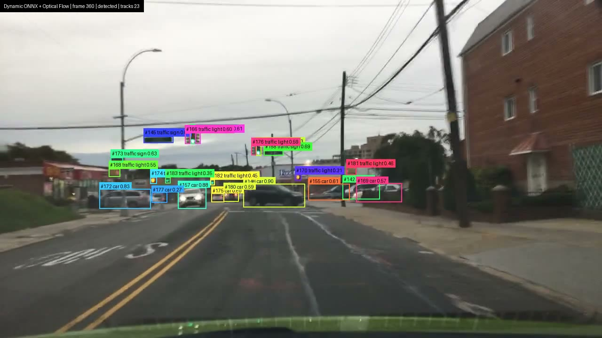
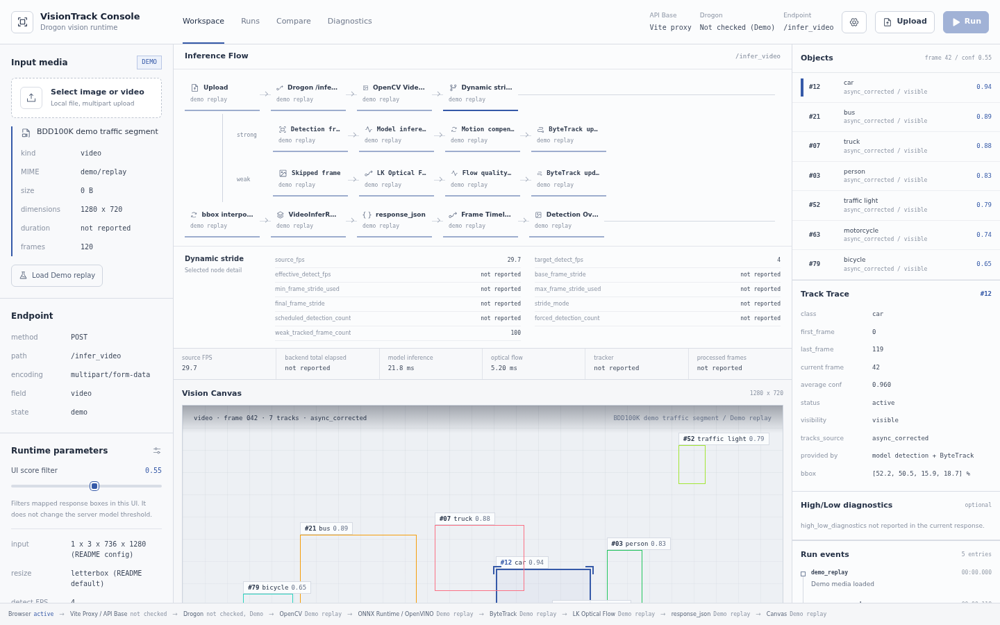
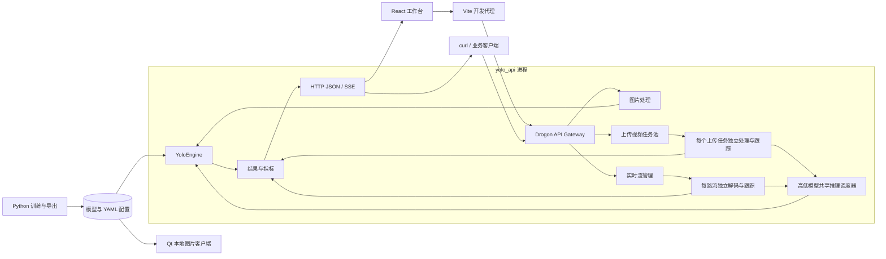

# VisionTrack

基于 YOLO26 的道路目标检测与视频跟踪项目，提供 C++ 推理服务、Web 工作台和 Qt 图片客户端。训练与导出使用 Python，部署使用 ONNX Runtime / OpenVINO CPU 推理，通过动态检测间隔、LK 光流和目标跟踪减少视频中的模型调用。

当前面向 BDD100K 道路场景，支持 `person`、`rider`、`car`、`truck`、`bus`、`train`、`motor`、`bike`、`traffic light`、`traffic sign` 共 10 类目标。

- [实现效果](#实现效果)
- [系统框架](#系统框架)
- [具体流程](#具体流程)
- [环境与运行](#环境与运行)
- [PTQ INT8 量化](#ptq-int8-量化)
- [模型训练与导出](#模型训练与导出)
- [验证与排查](#验证与排查)
- [当前限制](#当前限制)
- [相关文档](#相关文档)

## 实现效果

### 视频检测与跟踪

[](Readme/dynamic_onnx_flow_detections.mp4)

上图截取自仓库已有预测视频的约第 12 秒，点击图片可查看完整视频。画面中车辆、交通灯和交通标志带有目标框；标签依次显示轨迹 ID、类别和分数。左上角标明当前帧、结果来源及轨迹数量，便于观察模型检测与光流传播的切换。

这张图和视频是已保存的演示结果。Web 工作台与 API 可用于验证当前代码和本地模型的输出。

### Web 工作台



| 区域 | 可查看内容 |
| --- | --- |
| 输入与请求 | 媒体信息、接口路径、上传字段、请求状态 |
| 结果画布 | 当前帧目标框、类别、分数和轨迹 ID |
| 时间线与轨迹面板 | 逐帧回放、轨迹出现区间、当前可见状态和结果来源 |
| 性能与事件面板 | 响应提供的阶段耗时、检测次数及请求诊断 |

上图使用内置 BDD100K Demo replay 展示界面。Demo 不发送推理请求；实际检测需连接后端、上传媒体并点击 `Run`。响应未提供的指标显示为 `not reported`。

### CPU 视频处理对比

2026-10-10 的 High + LK 分阶段实验，在同一组本地视频上对比 FP32 与 INT8：

| 指标 | FP32 + LK | INT8 + LK |
| --- | ---: | ---: |
| 整链路处理吞吐 | 25.68 FPS | 33.61 FPS |
| 单次模型推理平均耗时 | 153.62 ms | 81.13 ms |
| 运行期平均 RSS | 337.06 MiB | 311.06 MiB |

该实验使用 OpenVINO CPU、1280×736 输入、固定 stride=8、同步单模型，三段视频各运行三轮。整链路加速约 **1.31×**，与单次模型推理加速不同。

这是跟踪时钟修复前的实验快照，不代表当前版本或多路 RTSP 性能；量化也需结合精度变化评估。阶段统计、实验条件和复现方法见 [对应测试说明](docs/test-results/high_stage_cpu_20261010/README.md)。

## 系统框架



| 模块 | 目录 | 职责 |
| --- | --- | --- |
| 模型开发 | `model/` | 训练、困难样本挖掘、蒸馏与 ONNX / INT8 导出 |
| Web 界面 | `front/` | React + TypeScript 工作台、上传与结果回放 |
| 服务入口 | `yolo_onnx_cpp/main.cpp`、`config/` | 配置解析、模型加载和服务启动 |
| HTTP 接入 | `yolo_onnx_cpp/drogon/` | 路由、请求门禁、上传任务池、JSON 与 SSE |
| 推理执行 | `yolo_onnx_cpp/image/`、`model/` | 预处理、输出解析、推理后端与共享调度 |
| 视频与实时流 | `yolo_onnx_cpp/video/`、`stream/` | 检测节奏、解码队列、光流、异步校正与流生命周期 |
| 跟踪与观测 | `yolo_onnx_cpp/tracking/`、`metrics/` | ByteTrack、AuthorityTracker、计时与资源统计 |
| 桌面界面 | `qt_ui/` | 直接复用 C++ 推理代码的 Qt Widgets 图片客户端 |

Gateway、视频 worker、实时流线程和调度器运行在同一个 `yolo_api` 进程内。每个上传任务、每路实时流各自维护帧历史、光流与跟踪状态；高、低模型分别拥有共享调度器，上传视频和实时流共用推理资源。轨迹 ID 属于当前任务或流，不用于跨摄像头身份识别。Qt 直接加载模型，不经过 HTTP。

| 使用场景 | 入口 | 结果交付 |
| --- | --- | --- |
| 单张图片检测 | Web、`/infer` 或 Qt | 检测框与类别；Qt 在本地显示 |
| 本地视频分析 | Web 或 `/infer_video` | 完整处理后返回逐帧轨迹与摘要 |
| 高低模型协同分析 | `/infer_video_high_low` | 逐帧轨迹、摘要与 High/Low 诊断 |
| 持续监测摄像头 | `/streams` | 独立运行，通过 SSE 持续订阅 |

Web 当前接入图片和单模型上传视频；High/Low 与实时流使用 API。实时流是否使用低模型由服务启动时的配置决定。

训练环境与 C++ 部署环境独立。在线服务不依赖 Python、数据库或消息队列；任务、轨迹和 SSE 缓存保存在内存中，进程重启后不恢复。

## 具体流程

### 1. 服务初始化

1. `main.cpp` 读取命令行指定的 YAML；未指定时使用构建 preset 选定的默认配置。
2. 解析模型路径、输入尺寸、类别、线程与队列限制。模型相对路径以 **YAML 所在目录** 为基准。
3. 加载高分辨率模型；配置了 `low_res_model_path` 时同时加载低分辨率模型。任一已配置模型加载失败，服务退出。
4. 创建请求门禁、上传视频任务池、高低模型调度器与实时流管理器。
5. 注册路由，在 `0.0.0.0:8080` 监听请求。

### 2. 图片检测

```text
上传 image → 请求校验 → OpenCV 解码 → letterbox / resize
→ RGB、归一化、NCHW float32 → 模型推理
→ 输出解析、坐标还原、class-aware NMS → HTTP JSON
```

结果包含检测框、类别、分数、输出 shape 和性能统计。当前部署 YOLO26 的输出为 `[1, 300, 6]`，每行是 `x1, y1, x2, y2, score, class_id`；服务还会执行外部 NMS，并保留旧候选输出格式的解析兼容。

### 3. 上传视频检测与跟踪

```text
上传 video → 暂存视频 → 有界视频任务池 → 逐帧解码
→ 检测节奏判断、LK 光流传播、模型结果校正、轨迹更新
→ 汇总帧结果与指标 → 一次性返回 JSON → 清理临时视频
```

| 环节 | 单模型 `/infer_video` | High/Low `/infer_video_high_low` |
| --- | --- | --- |
| 强检测 | 使用高分辨率模型 | 高模型负责权威校正，低模型负责较频繁刷新 |
| 检测间隔 | 按源 FPS 和 `video_detect_fps` 计算基础 stride；动态模式随运动与光流质量调整 | 低模型按动态 stride 检测，高模型由基础 stride 推导刷新周期，必要时提前触发 |
| 中间帧 | LK 光流传播已有目标，ByteTrack 更新轨迹 | LK 光流传播，AuthorityTracker 管理稳定、候选与生命周期状态 |
| 异步模式 | worker 执行模型，结果返回后补偿到当前时间线 | 高模型可异步执行，返回后进行历史回放校正；低模型在文件处理线程等待结果 |
| 输出 | 逐帧轨迹、来源、检测次数与阶段指标 | 逐帧轨迹及额外 High/Low 诊断 |

例如源视频 24 FPS、`video_detect_fps=4` 时，单模型基础 stride 为 6。固定间隔、同步执行时可按下面理解；默认动态与异步模式下，调用位置和校正时机可能变化：

| 源帧 | 第 0 帧 | 第 1–5 帧 | 第 6 帧 |
| --- | --- | --- | --- |
| 模型调用 | 检测 | 不调用 | 检测 |
| 目标位置 | 模型确认 | LK 光流传播 | 模型重新校正 |
| 轨迹更新 | 检测关联 | 光流更新 | 检测关联 |

模型负责发现目标与校正位置，光流只传播已有目标。动态模式在光流质量下降或目标运动变化时提前检测；`video_detect_fps=0` 表示逐帧检测。

单模型帧结果通过 `tracks_source` 标明来源：

| 来源 | 含义 |
| --- | --- |
| `detected` | 同步模型检测与轨迹关联 |
| `async_corrected` | 异步检测返回后，经过时间补偿的校正结果 |
| `weak_tracked` | LK 光流传播已有目标 |
| `interpolated` | 相邻检测帧间的插值兜底 |
| `empty` | 当前没有可用轨迹 |

**上传视频请求需要等待完整处理结束。** 内部 worker 异步执行不改变 HTTP 的一次性响应方式。`include_frames=false`、`frame_offset`、`frame_limit` 仅裁剪返回结果，不减少视频推理工作。

`frame_offset=N` 按结果数组的下标裁剪，从 0 开始；`frame_limit=N` 最多返回 N 帧且 N 必须为正整数。返回结果中的 `frames_returned` 和 `has_more_frames` 描述本次裁剪范围，服务不会保存剩余帧供后续查询；重新请求会重新推理。

### 4. 多路实时流

1. 客户端调用 `POST /streams`，提交唯一 `stream_id` 和视频源 `source`。
2. 管理器注册流并返回 `201`，为该流启动解码与处理线程；创建成功仅表示已注册，连接状态需继续查询。
3. 解码帧进入有界队列。实时源优先保留新帧并丢弃过期结果，本地文件通过背压等待处理。
4. 处理线程进行光流传播、检测调度与轨迹更新；多个流通过高低模型共享调度器约束推理并发。
5. 在开启 `video_model_async` 且所需调度器可用时，实时源采用非阻塞推理和历史回放校正；本地文件、关闭异步或缺少所需调度器时采用同步处理分支。
6. `GET /streams/{id}/events` 通过 SSE 输出结果，`GET /streams/{id}` 查询状态，`GET /metrics` 查看累计指标。
7. 调用 `DELETE /streams/{id}` 停止并释放注册名额。已完成或失败的记录也需要 DELETE 释放。

双模型实时流以 `video_detect_fps` 控制低模型刷新、`video_high_detect_fps` 控制高模型周期；单模型实时流使用 `video_detect_fps` 调度高模型。上传 High/Low 视频的高模型周期由基础 stride 推导。实时异步分支按本地解码时钟安排调用，不按摄像头声明的 FPS 直接计数。

SSE 普通事件名为 `detection`，光流结果也使用该名称；终止事件为 `end`。断线重连可携带 `Last-Event-ID` 补发内存缓存中的后续事件，每路最多缓存 256 条。游标过旧或超前会收到 `error` 并关闭连接；进程重启或记录删除后不能恢复。

## 环境与运行

服务端与 Qt 使用仓库现有 `/root/vcpkg`、`x64-linux-gcc15` triplet 和 GCC15 toolchain，具体边界见 [AGENTS.md](AGENTS.md)。以下命令均注明起始目录，后端与前端分别在独立终端运行。

### 1. 准备环境与模型

| 用途 | 环境 / 依赖 | 说明 |
| --- | --- | --- |
| C++ 服务 | CMake ≥ 3.20、Ninja、GCC15；vcpkg 中的 Drogon、OpenCV、ONNX Runtime、jsoncpp | OpenVINO 是可选构建后端 |
| Web 工作台 | Node.js / npm | 依赖由 `front/package-lock.json` 锁定 |
| 训练、导出及 Python 测试 | Conda `yolo` | 规格见 [envs/yolo.yml](envs/yolo.yml) |
| Qt 客户端 | 同一 vcpkg 工具链、Qt6 Widgets | 详见 [Qt 说明](qt_ui/README.md) |

`rag-api` 不参与本项目推理流程，不需要为启动 VisionTrack 创建该环境。已有 Python 环境的边界见 [环境说明](envs/README.md)。

模型需要本地准备，服务不会自动下载。默认配置需要以下两个权重：

```bash
# 仓库根目录
ls -lh yolo_onnx_cpp/deploy/best.onnx \
  yolo_onnx_cpp/deploy/best_640x384.onnx
```

核对 [config.yaml](yolo_onnx_cpp/config.yaml) 中的路径与输入尺寸：高模型 `1280×736`，低模型 `640×384`。类别从 YAML 的 `class_names` 读取，`classes.json` 是导出元数据。只使用单模型时，可在自己的配置中清空 `low_res_model_path`。

### 2. 构建并启动后端

默认 ONNX Runtime 路径：

```bash
# 从仓库根目录开始
cd yolo_onnx_cpp
cmake --preset vcpkg-gcc15-release
cmake --build --preset vcpkg-gcc15-release
../build/yolo_api config.yaml
```

需要 OpenVINO 时，使用包含该后端的 preset；环境须已准备好可由 CMake 找到的 OpenVINO Runtime：

```bash
# 从仓库根目录开始
cd yolo_onnx_cpp
cmake --preset vcpkg-gcc15-openvino
cmake --build --preset vcpkg-gcc15-openvino
../build-openvino/yolo_api config.multistream.yaml
```

| 配置 | 用途 | 关键区别 |
| --- | --- | --- |
| [config.yaml](yolo_onnx_cpp/config.yaml) | 默认图片与视频流程 | `.onnx` + `auto` 使用 ONNX Runtime，默认动态 stride 与异步模式 |
| [config.reference.yaml](yolo_onnx_cpp/config.reference.yaml) | 单模型逐帧检测参考 | `video_detect_fps=0`、关闭异步、无低模型 |
| [config.multistream.yaml](yolo_onnx_cpp/config.multistream.yaml) | CPU 多路调参起点 | 显式 OpenVINO、throughput、分别配置高低模型与服务线程 |

`auto` 对 `.onnx` 选择 ONNX Runtime，对 `.xml` 选择 OpenVINO；使用 OpenVINO 加载 ONNX 时需要显式配置 `model_backend: openvino`。多路配置是调参起点，线程数和请求池大小需按实际负载验证。

服务日志输出到终端，使用 `Ctrl-C` 停止。默认使用 HTTP，鉴权与限流关闭；可通过配置启用 Bearer 门禁、限流及 TLS。

### 3. 关键配置

以下值来自默认 `config.yaml`，多路配置可能不同。修改 YAML 后需要重启服务。

| 配置项 | 默认值 | 作用与调整依据 |
| --- | --- | --- |
| `conf_threshold` / `iou_threshold` | `0.25` / `0.45` | 模型输出分数过滤与外部 NMS，调整后需重新检查漏检与重复框 |
| `use_letterbox` | `true` | 保持宽高比并补边；输入宽高仍需匹配模型静态 shape |
| `video_detect_fps` | `4.0` | 上传视频的基础采样频率、实时流的模型刷新预算；不是视频处理吞吐 |
| `video_high_detect_fps` | `1.0` | 双模型实时流的高模型周期；0 关闭周期刷新，保留首帧与紧急检测 |
| `video_stride_mode` / `video_model_async` | `dynamic` / `true` | 前者调整上传视频检测间隔，后者控制视频与实时流的异步分支 |
| `max_streams` | `4` | 同时注册的流数量上限，包含尚未删除的终态记录 |
| `per_stream_queue_depth` | `2` | 每路帧队列与推理排队的容量限制 |
| `max_request_age_ms` | `300` | 共享调度器对排队请求的新鲜度约束 |
| `max_result_age_ms` | `300` | 实时源从本地解码到结果输出的时限；0 关闭过期丢弃 |
| `video_job_threads` / `video_job_queue_depth` | `2` / `4` | 上传视频任务的执行线程与等待容量，满载时返回 503 |
| `client_max_body_mb` / `client_max_memory_body_mb` | `256` / `16` | 请求体总上限与内存存储阈值，大请求可暂存到磁盘 |

模型线程通过 `high_model_threads`、`low_model_threads` 设置：高模型为 0 时回退到 `thread_num`，低模型为 0 时继承解析后的高模型线程数。`server_io_threads=0` 回退到 `thread_num`；`opencv_threads=0` 时服务不主动设置 OpenCV 线程数。

OpenVINO 的 `infer_request_count=0` 使用运行时报告的最优请求数量；`low_res_infer_request_count=0` 继承高模型请求数量配置。线程数与请求数需一起验证，增加线程或并发并不保证降低延迟。

### 4. 检查服务并启动 Web

先在新终端确认服务可访问：

```bash
curl -i http://127.0.0.1:8080/health
curl -i http://127.0.0.1:8080/ready
```

预期分别返回 `{"status":"ok"}` 和 `{"status":"ready"}`。这两个接口免鉴权和限流，`/ready` 仅检查流管理器是否存在；实际推理仍需上传图片验证。

然后启动工作台：

```bash
# 从仓库根目录开始，在另一个终端运行
cd front
npm ci
npm run dev
```

打开 Vite 输出的访问地址。默认通过 [vite.config.ts](front/vite.config.ts) 将图片与视频请求代理到 `127.0.0.1:8080`。后端不在同机时，修改代理 `target`；`VITE_API_BASE_URL` 则会让浏览器直接请求该地址，跨域时需由部署侧配置 CORS 或使用同源反向代理。生产构建使用 `npm run build`，代理需由部署环境提供。

工作台操作顺序：

1. 点击 `Upload` 或 `Select image or video` 选择媒体，确认接口与上传字段随媒体类型切换。
2. 点击 `Run` 发起请求。视频需等待完整处理结束，再进入结果回放。
3. 在画布和结果列表查看目标；视频可通过时间线播放、暂停或逐帧定位，并选择轨迹查看出现区间。
4. 查看请求状态与性能指标；报错时先检查事件面板和后端终端日志。

`UI score filter` 只过滤已经返回的目标框，不改变服务端 `conf_threshold`，也不重新运行推理。`Load Demo replay` 可在未连接后端时演示界面。

### 5. 调用 API

| Method | Path | 请求内容 / 用途 |
| --- | --- | --- |
| POST | `/infer` | multipart 字段 `image`，图片检测 |
| POST | `/infer_video` | multipart 字段 `video`，单模型视频跟踪 |
| POST | `/infer_video_high_low` | multipart 字段 `video`，高低模型协同 |
| POST | `/streams` | JSON 字段 `stream_id`、`source`，注册视频源 |
| GET | `/streams`、`/streams/{id}` | 流列表与状态 |
| DELETE | `/streams/{id}` | 停止并释放流 |
| GET | `/streams/{id}/events` | SSE 结果订阅 |
| GET | `/health`、`/ready`、`/metrics` | 健康、就绪与 Prometheus 指标 |

图片及上传视频示例，替换为本地媒体路径：

```bash
curl -X POST http://127.0.0.1:8080/infer \
  -F 'image=@/path/to/image.jpg'

curl -X POST 'http://127.0.0.1:8080/infer_video?include_frames=false' \
  -F 'video=@/path/to/video.mp4'

curl -X POST 'http://127.0.0.1:8080/infer_video_high_low?include_frames=false' \
  -F 'video=@/path/to/video.mp4'
```

实时源示例，`source` 必须是 **服务端可访问** 的地址或本地文件路径：

```bash
curl -X POST http://127.0.0.1:8080/streams \
  -H 'Content-Type: application/json' \
  -d '{"stream_id":"cam-01","source":"rtsp://camera-host/stream"}'

curl http://127.0.0.1:8080/streams/cam-01
curl -N http://127.0.0.1:8080/streams/cam-01/events

# 在另一终端停止流，或结束订阅后执行
curl -X DELETE http://127.0.0.1:8080/streams/cam-01
```

`stream_id` 为 1–64 个字母、数字、`.`、`_` 或 `-`。开启鉴权后，除 `/health`、`/ready` 外，请求需携带 `Authorization: Bearer <token>`。字段定义以 [响应序列化](yolo_onnx_cpp/drogon/response_json.cpp) 和 [API 契约测试](yolo_onnx_cpp/test_cpp/api_gateway_contract_test.cpp) 为准。

上传接口返回后，可按下表读取结果：

| 字段 | 含义 |
| --- | --- |
| `code` / `message` | 应用结果状态，上传推理成功时 `code=0` |
| `detections[]` | 图片检测目标，包含类别、分数和 `box` |
| `frames[].tracks[]` | 视频轨迹，包含 `track_id` 及对应检测字段 |
| `box.x1/y1/x2/y2` | 还原到原图坐标系的像素坐标 |
| `source_fps` / `target_detect_fps` | 视频源帧率与目标检测频率 |
| `average_fps` | 视频实际处理吞吐，与源帧率和检测频率分别解读 |
| `timing_ms` | 解码、预处理、推理、光流、跟踪、排队等阶段累计耗时 |
| `high_low_diagnostics` | 高低模型调用、轨迹更新等诊断计数 |

异步模式下不同线程的耗时可能重叠，阶段累计值不能相加当作整次请求的墙钟耗时。浏览器显示的请求耗时还包含上传和响应传输。

实时流的 `201` 响应没有上传接口的结果结构。创建后应查询状态，并观察 `processed_frame_count` 与 `latest_sequence` 是否持续增长：

| 流状态 | 含义与下一步 |
| --- | --- |
| `starting` / `reconnecting` | 正在打开或重新连接源，继续查询并检查可达性 |
| `running` | 已连接，结合处理计数和 SSE 确认结果持续输出 |
| `completed` | 本地文件已处理完成，删除记录以释放名额 |
| `failed` / `expired` | 处理失败或达到配置时限，查看 `last_error` 后删除记录 |
| `stopping` / `stopped` | 正在停止或已经停止 |

断开 SSE 订阅不会停止视频源；需单独 DELETE。DELETE 成功返回 `{"stream_id":"cam-01","status":"stopped"}`，随后查询该 ID 返回 404。保存最近一次 SSE `id` 后，可在重连时将其作为 `Last-Event-ID` 请求头值。

### 6. 可选：Qt 图片客户端

```bash
# 从仓库根目录开始，需要图形会话
bash qt_ui/check_env.sh
cd qt_ui
cmake --preset vcpkg-gcc15-release
cmake --build --preset vcpkg-gcc15-release
../build-qt/yolo_qt
```

## PTQ INT8 量化

高分辨率模型支持训练后量化（PTQ）及敏感层排除。直接PTQ使用MinMax校准，Conv输入为U8、权重为逐通道对称S8，bias、Conv输出和其他算子保持浮点；优化时将敏感Conv保留FP32，其余继续INT8。**本次优化没有训练、QAT或源权重更新**，最终产物是INT8/FP32混合精度ONNX，不是全网络整数计算。

2026-10-12对当前部署的`best.onnx`进行实测，固定输入`[1,3,736,1280]`，独立验证集1000张图片：

| 模型 | mAP50 | mAP50-95 | 平均推理延迟 | INT8 / FP32 Conv |
| --- | ---: | ---: | ---: | ---: |
| 原始FP32 | 60.583% | 35.033% | 255.840 ms | 0 / 102 |
| 直接PTQ INT8 | 58.519% | 32.415% | 117.817 ms | 102 / 0 |
| 优化混合精度PTQ | 60.209% | 34.857% | 116.333 ms | 94 / 8 |

敏感层排查先比较全部102个Conv的局部QDQ误差和累计误差，再对23个候选进行单层排除，并验证正收益层的组合，共27组消融。校准、诊断、调优、最终评测使用分离的数据；层选择仅使用256张调优图片，不使用最终评测结果。所有候选复用同一次200张图片的MinMax校准统计。

优化模型保留8个Conv为FP32，恢复93.27%的直接PTQ精度损失，与FP32的mAP50-95差距缩小到0.176个百分点，同时满足保留至少80%推理时间节省的约束。两种INT8模型的微小延迟差异没有显著性检验，不应解读为优化方案必然更快。

上述延迟使用OpenVINO CPU、8线程、单请求、LATENCY及显式FP32浮点精度；各组独立进程预热10次，用相同100个输入测量三轮并轮换顺序。延迟仅含推理与输出读取，不含前后处理或视频跟踪，不能与前述视频整链路FPS直接比较。数据是固定验证子集结果，稀有类别和真实RTSP场景仍需另行验收；本次实验未替换部署模型或修改服务配置。

排查入口为`model/ptq_analysis.py`，单独PTQ导出使用`model/ptq_int8.py`；后者支持重复传入`--exclude-node`，节点名必须与预处理图中的Conv精确匹配。所有输出需写入不存在的新目录，模型权重和逐样本原始运行数据保留在本地，不纳入Git。

```bash
# 仓库根目录，使用已有 yolo 环境和本地数据
conda run -n yolo python model/ptq_analysis.py --help
conda run -n yolo python model/ptq_int8.py --help
conda run -n yolo python -m unittest model.test_ptq_analysis
```

完整参数见[量化说明](model/quantization.md)，实测逐层排名、排除节点、消融结果、三段视频复测及检测对照见[高分辨率PTQ优化报告](docs/test-results/high_ptq_analysis_20261012_191035/report.md)。报告中区分了局部量化误差、共享输入QDQ和上游误差传播，不将“误差大”直接等同于“应保留FP32”。

## 模型训练与导出

仅运行 C++ 服务与 Web 时，可以跳过本节。数据集与本地训练权重需自行准备。

PTQ INT8 与 QAT INT8 的独立脚本、参数及对比方法见 [量化说明](model/quantization.md)。

```bash
# 仓库根目录；仅首次创建环境时执行 env create
conda env create -f envs/yolo.yml
conda run -n yolo python -m pip check
conda run -n yolo python model/train.py --help
conda run -n yolo python model/onnx.py --help
```

训练支持 `base`、`hard`、`distill` 阶段；`hard` 需基础权重与困难样本清单，`distill` 需 teacher 权重。先使用 `--dry-run` 检查配置和数据，再按选定参数训练。检查仍会生成运行配置与采样清单，应指定新的 `--project` / `--name`，避免复用已有实验目录。

基础训练检查示例，替换为已准备的数据集、权重和新输出路径：

```bash
conda run -n yolo python model/train.py \
  --stage base \
  --dataset-dir /path/to/bdd100k_yolo_det \
  --model /path/to/local/student.pt \
  --project /path/to/new-training-runs \
  --name bdd100k_base \
  --dry-run
```

检查通过后，移除 `--dry-run` 开始训练，并按资源设置 `--batch`、`--epochs`、`--device`。训练与验证的 `--imgsz` 是单个最长边尺寸，ONNX 导出的 `--imgsz` 是高、宽两个参数。

`model/train.py` 保留已设置的 `CUDA_VISIBLE_DEVICES`；未设置时默认暴露 GPU 4、5。`--device auto` 使用第一张可见 GPU，无 CUDA 时回退 CPU；双卡需显式指定 `--device 0,1`。

FP32 导出示例：

```bash
conda run -n yolo python model/onnx.py \
  --pt /path/to/local/best.pt \
  --imgsz 384 640 \
  --deploy-dir /path/to/new-export \
  --skip-int8
```

尺寸顺序为 **高、宽**；导出高模型时使用 `--imgsz 736 1280 --fp32-name best.onnx`。需要 INT8 时移除 `--skip-int8`，并通过 `--data` 指定校准数据 YAML；高模型还应设置对应的 `--int8-name`。脚本默认 opset 13，拒绝覆盖已有输出。导出完成后，将服务配置指向新模型，并同步输入尺寸及类别顺序。

## 验证与排查

已有构建与依赖准备好后，运行相关检查：

```bash
# 从仓库根目录开始
cd yolo_onnx_cpp
ctest --preset vcpkg-gcc15-release

cd ../front
npm run build
```

OpenVINO 构建对应 `ctest --preset vcpkg-gcc15-openvino`。CTest 包含配置、预处理、跟踪、调度器、实时流、JSON 和 API 契约回归；找到 Conda 时还会注册 `yolo` 环境中的 Python 工具测试。部分集成测试需要本地模型、演示视频，并使用 8080 端口，执行前停止手动启动的服务。

| 现象 | 优先检查 |
| --- | --- |
| 启动失败或模型加载失败 | YAML 路径、模型文件、静态输入尺寸与后端是否匹配 |
| OpenVINO 后端不可用 | 是否使用 `vcpkg-gcc15-openvino` 构建，Runtime 是否可被找到 |
| Web 请求失败 | 后端是否在运行、Vite 代理地址、浏览器直连时的跨域配置 |
| `/streams` 返回 409 | `stream_id` 是否重复、注册数是否达到 `max_streams`，终态流是否已删除 |
| 实时流无结果 | `/streams/{id}` 的状态、源地址可达性、错误与重连计数 |
| 延迟或丢帧增加 | `/metrics` 中的队列、过期、丢帧计数，以及线程与请求池配置 |

参数或媒体错误通常返回 400，内部异常返回 500；门禁启用后可能返回 401 / 429，上传视频任务池满返回 503。

测试源码位于 `yolo_onnx_cpp/test_cpp/`、`yolo_onnx_cpp/test/`、`model/test_training_quality_pipeline.py` 和 `model/test_quantization.py`。测试脚本的默认产物目录为 `yolo_onnx_cpp/test_outputs/`，部分 CTest smoke 产物位于构建目录；版本管理中的历史快照集中在 `docs/test-results/`。

## 当前限制

- 上传视频等待完整响应，长视频的处理时间、帧结果缓存与响应体占用需单独评估；摘要模式仅减少返回数据。
- 任务与 SSE 缓存不持久化，上传接口没有任务查询、续算或幂等机制。
- Web 尚未接入 High/Low 与实时流管理，也未提供 Bearer token 输入；启用门禁后需由接入侧补充鉴权请求头。Qt 仅支持本地图片推理。
- 健康探针不验证摄像头连接、检测精度或目标吞吐。
- 当前多路配置及历史量化收益仍需在真实 RTSP、目标机器和业务真值上验收。

## 相关文档

- [文档与实验索引](docs/README.md)：报告、历史验证与资源入口。
- [系统实现与验证综合报告](docs/reports/系统实现与验证综合报告.md)：训练量化、跟踪时钟、ROI、调度回放与测量口径。
- [技术报告导航](docs/reports/README.md)：按问题查阅，定位历史实验与实施记录。
- [初始化到多 IP 任务提交完整流程](docs/reports/初始化到多IP任务提交完整流程.md)：详细调用链、队列与 SSE 行为。
- [多路实时监测代码速读](docs/reports/多路实时监测代码速读记录_20260908.md)：源码阅读顺序。
- [环境说明](envs/README.md)、[Qt 客户端说明](qt_ui/README.md)：环境边界与桌面构建。
